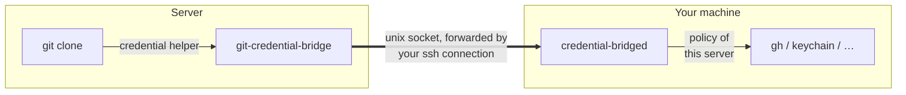

# credential-bridge

**ssh-agent forwarding, but for your git tokens.**

Log in to GitHub once, on your own machine. Then `git clone`, `fetch` and `push` over
HTTPS on every server you ssh into, with no token stored on any of them.

```console
you@laptop:~$ ssh buildserver
me@buildserver:~$ git clone https://github.com/my-org/private-repo
Cloning into 'private-repo'...
```

No token was pasted, nothing was prompted, and nothing was written to the server's disk.
git asked your laptop, your laptop asked `gh`, and the answer travelled back through the
ssh connection you already had open.

<!-- prettier-ignore -->
> [!WARNING]
> **credential-bridge is beta.** It is new and has seen little real-world use yet. It
> is covered by extensive automated tests (unit and integration tests, every server
> helper under qemu, the release package, and an end-to-end test with real ssh and git
> in five VMs), but:
>
> - macOS is built and linted, but not yet tested on a real Mac.
> - The aarch64 and s390x helpers have only run under emulation, not on real hardware.
> - Release packages are not signed yet; check them against `SHA256SUMS`.
> - Configuration and the protocol between helper and daemon may still change between
>   0.x versions.
>
> Try it on a test server first, keep allow lists narrow, and please
> [report what you run into](../../issues).

## Sound familiar?

- You ran `gh auth login` on the build server, the dev VM and that one box in the lab,
  and now there are three long-lived tokens on three machines you don't fully control.
- `~/.git-credentials` holds a token **in plain text** on a shared host.
- A token expires, and you get to hunt it down on every server.
- You'd love to just forward your agent, but these repos use **HTTPS** URLs and your
  organisation hands out tokens, not ssh keys.

credential-bridge fixes all four: tokens stay where they belong, on your machine, and
servers borrow them one request at a time, only while you are connected.

## How it compares

|                                         | Token copied to the server<br/>(`gh auth login`, PAT) | `~/.git-credentials` | ssh-agent forwarding |        **credential-bridge**         |
| --------------------------------------- | :---------------------------------------------------: | :------------------: | :------------------: | :----------------------------------: |
| Nothing secret on the server's disk     |                           ✗                           |          ✗           |          ✓           |                **✓**                 |
| Works with HTTPS remotes and `gh`       |                           ✓                           |          ✓           |  ✗ (ssh URLs only)   |                **✓**                 |
| Works only while you are connected      |                           ✗                           |          ✗           |          ✓           |                **✓**                 |
| Limit a server to certain orgs or repos |                           ✗                           |          ✗           |          ✗           |                **✓**                 |
| Rotate or log out once, for all servers |                           ✗                           |          ✗           |          ✓           |                **✓**                 |
| Every request visible in one log        |                           ✗                           |          ✗           |          ✗           |                **✓**                 |
| Something to install on the server      |                          gh                           |          –           |          –           | one static binary, installed for you |

If you know ssh-agent forwarding, you already know the idea: the secret stays home, the
server asks for it through your ssh connection. credential-bridge does that for git's
HTTPS credentials, and adds a policy per server on top.

## Get started in two minutes

**You need:** `gh` logged in on your machine (`gh auth login`), Linux or macOS. **The
server needs:** sshd and git. You don't install anything there yourself.

**1. Install it on your machine**, either way:

<table>
<tr><th>Without Nix (Linux)</th><th>With Nix (Linux, macOS)</th></tr>
<tr><td>

Download `credential-bridge-<version>-x86_64-linux.tar.gz` (or `aarch64`) from the
[latest release](../../releases/latest), then:

```sh
tar xzf credential-bridge-*.tar.gz
./credential-bridge-*/install.sh
```

Static binaries, no dependencies, no root. Installs into `~/.local`.

</td><td>

No checkout needed:

```sh
nix run github:XeS0r/ssh-credential-bridge#install
```

Builds everything reproducibly and links it into `~/.local`. From a checkout:
`nix run .#install`.

</td></tr>
</table>

Then start the background daemon (systemd on Linux, launchd on macOS):

```sh
credential-bridge-ctl service install
```

**2. Add a server** and say what it may use:

```sh
credential-bridge-ctl remote add buildserver --allow 'https://github.com/my-org/*'
credential-bridge-ctl remote install buildserver
```

```text
✓ connect        buildserver · x86_64-linux · git 2.56.0
✓ upload helper  ~/.local/bin/git-credential-bridge · 1.0 MB
✓ configure git  github.com
⚠ ssh config     has no RemoteForward for the socket
```

**3. Let your ssh connection carry it.** Append the one line it prints to your ssh
config:

```sh
credential-bridge-ctl remote ssh-config buildserver >> ~/.ssh/config
```

**4. Check, and go:**

```console
$ credential-bridge-ctl remote check buildserver
daemon ━ ssh config ━ ssh ━ helper ━ git    ready

$ ssh buildserver
$ git clone https://github.com/my-org/private-repo
```

That's it. Every server after that is step 2 and 3 again.

## How it works



1. git on the server asks its credential helper, `git-credential-bridge`, for a token.
2. The helper sends the question through a socket that your ssh connection forwards to
   your machine (`RemoteForward`, like agent forwarding).
3. `credential-bridged` checks what this server may ask for, gets the token from `gh`
   (or your keychain) and sends it back. git uses it once and forgets it.

Each server gets its own socket on your machine, so a server can never pretend to be
another one and ask for more than its own policy allows.
[docs/architecture.md](docs/architecture.md) tells the whole story with diagrams.

## Everyday use

| You want to …                       | Run                                                                                          |
| ----------------------------------- | -------------------------------------------------------------------------------------------- |
| see all servers at a glance         | `credential-bridge-ctl remote list`                                                          |
| let a server use another org        | `credential-bridge-ctl remote edit buildserver --add-allow 'https://github.com/other-org/*'` |
| see what was asked and answered     | `credential-bridge-ctl service logs -f`                                                      |
| find out why something doesn't work | `credential-bridge-ctl doctor`, `credential-bridge-ctl remote check NAME`                    |
| remove a server again               | `credential-bridge-ctl remote uninstall NAME && credential-bridge-ctl remote remove NAME`    |
| update credential-bridge            | the new release's `install.sh`, or the `nix run …#install` again                             |

Every problem comes with the command that fixes it, also on the server, right inside
git's output:

```text
credential-bridge: github.com/other-org/repo is not allowed for this remote
  → locally: credential-bridge-ctl remote edit buildserver --add-allow 'https://github.com/other-org/*'
```

```text
credential-bridge: no credential for github.com on your local machine
  → locally: gh auth login --hostname github.com
```

## Questions

<details>
<summary><b>Is it safe?</b></summary>

Tokens never touch the server's disk; they exist there only in the memory of the git
process that asked. Each server gets only what its allow list permits, and only `get`
unless you allow `store`. Only your own user can talk to the daemon. The honest limit is
the same as with agent forwarding: while your session is open, someone with your account
or root on that server can ask through the socket, within its policy. Keep allow lists
narrow on shared machines. Details:
[security properties](docs/architecture.md#security-properties). Found a vulnerability?
Please report it privately, see [SECURITY.md](SECURITY.md).
</details>

<details>
<summary><b>What happens when I'm not connected through ssh?</b></summary>

Nothing breaks. git simply gets no answer from the helper and asks for a username as it
always would; the helper prints one line saying you are not connected.
</details>

<details>
<summary><b>Only GitHub and <code>gh</code>?</b></summary>

No. Any git credential helper works as the backend: `osxkeychain`, `libsecret`,
`manager` (Git Credential Manager), `store`, or a command of your own. Set `backend` in
the config, globally or per server. Allow lists work for any HTTPS host, e.g.
`https://gitlab.example.com/team/*`.
</details>

<details>
<summary><b>Which servers are supported?</b></summary>

Linux on x86_64, aarch64 and s390x (IBM Z). The helper is a single static binary;
`remote install` detects the platform and uploads the right one. Your own machine can be
Linux (release package or Nix) or macOS (Nix or cargo). Windows is not supported yet.

Tested so far: Linux x86_64 for real; aarch64 and s390x helpers under qemu; macOS only
built and linted (see the beta note above).
</details>

<details>
<summary><b>Several ssh sessions to the same server?</b></summary>

Works. The newest session carries the socket; if you close it while older ones stay
open, those lose the bridge until you reconnect. `ControlMaster auto` with
`ControlPersist` in your ssh config avoids that by sharing one connection.
</details>

<details>
<summary><b>Can I set up a server by hand, without <code>credential-bridge-ctl</code>?</b></summary>

Yes. Copy the helper for its platform (in a release package under
`share/credential-bridge/helpers/`, or `nix build .#git-credential-bridge-x86_64-linux`)
to `~/.local/bin/git-credential-bridge` on the server and run
`git-credential-bridge setup 'https://github.com/my-org/*'` there. It registers itself
with git the way `gh auth setup-git` does.
`git-credential-bridge uninstall --remove-binary` removes it again.
</details>

## Reference

### Commands

```text
credential-bridge-ctl service  install | uninstall | start | stop | restart | reload | status | logs
credential-bridge-ctl remote   add | edit | remove | list | show | ssh-config | install | check | uninstall
credential-bridge-ctl config   path | show | init | edit | validate
credential-bridge-ctl test     <remote> <url>     # a request through the server's socket, token redacted
credential-bridge-ctl doctor                      # check everything on this machine
credential-bridge-ctl completions <shell>
```

Every command has `--help`, and man pages and bash/fish completions come with the
install. Colors appear only on a terminal (`--color=auto|always|never`, `NO_COLOR` is
honoured); `-v` shows details such as the ssh commands run. On a server,
`CREDENTIAL_BRIDGE_VERBOSE=1` makes the helper's messages more detailed.

### Configuration

`~/.config/credential-bridge/config.toml`, managed by the `remote` commands
(`credential-bridge-ctl config edit` to edit it by hand):

```toml
backend = "!gh auth git-credential"   # any git credential.helper
timeout_secs = 30

[[remote]]
name = "buildserver"
ssh_host = "me@build.example.com"     # default: name
allow = ["https://github.com/my-org/*"]
operations = ["get"]                  # add "store" / "erase" only if you want them
# backend = "osxkeychain"             # per-server override
```

### Server requirements

sshd and git. `StreamLocalBindUnlink yes` in the server's `sshd_config` is recommended:
without it a socket left over from an interrupted connection blocks the next one
(`remote check` tells you when that happens).

### Install details

| Way                 | What it does                                                                                                                                                                                                                                                                                                                           | Remove                                                 |
| ------------------- | -------------------------------------------------------------------------------------------------------------------------------------------------------------------------------------------------------------------------------------------------------------------------------------------------------------------------------------- | ------------------------------------------------------ |
| Release package     | `install.sh` copies the static programs, the helpers for every server platform, man pages and completions into `~/.local` (`--prefix DIR` for another place). Running a newer package's `install.sh` updates and restarts the service.                                                                                                 | `install.sh --uninstall`                               |
| Nix                 | `nix run github:XeS0r/ssh-credential-bridge#install` (from a checkout `nix run .#install` or `just install`) builds everything, protects it from garbage collection with a root in `~/.local/share/credential-bridge/package` and links it into `~/.local` (`PREFIX` changes that). Running it again updates and restarts the service. | `nix run github:XeS0r/ssh-credential-bridge#uninstall` |
| From source (cargo) | `cargo install --locked --path crates/ctl` and `--path crates/daemon` build the local programs. Servers need a static helper: take it from a release package and put it into `~/.local/share/credential-bridge/helpers/`, or pass `remote install --binary PATH`.                                                                      | `cargo uninstall …`                                    |

Your configuration in `~/.config/credential-bridge/` is never touched. Release packages
are built by `nix build .#release` and are reproducible.

## Development

Everything runs through Nix; `nix develop` (or direnv) gives you the toolchain and
`just`.

```sh
just test          # unit and integration tests, seconds
just e2e           # end-to-end: 3 VMs with real ssh and git run every command (needs KVM)
just check         # everything CI runs: build, tests, clippy (Linux + macOS), rustfmt,
                   # static helpers for x86_64/aarch64/s390x tested under qemu, e2e
just vm            # a throwaway server to try it by hand (sshd on 127.0.0.1:2222, test/test)
```

<details>
<summary>Trying it against the throwaway server</summary>

`just vm` starts a NixOS guest in your terminal (quit with Ctrl-A X). Its disk lives in
memory, so every start is fresh. Add it to your ssh config and follow the quick start
with `testbox` as the name:

```text
Host testbox
    HostName 127.0.0.1
    Port 2222
    User test
    StrictHostKeyChecking no
    UserKnownHostsFile /dev/null
```

</details>

| Crate           | What it is                                                    |
| --------------- | ------------------------------------------------------------- |
| `crates/proto`  | wire format: git's credential format, request/response frames |
| `crates/core`   | configuration, paths, policy                                  |
| `crates/daemon` | `credential-bridged`                                          |
| `crates/ctl`    | `credential-bridge-ctl`                                       |
| `crates/helper` | `git-credential-bridge`, the static binary for servers        |

The design, with diagrams of every flow, is in
[docs/architecture.md](docs/architecture.md).

## License

[MIT](LICENSE)
