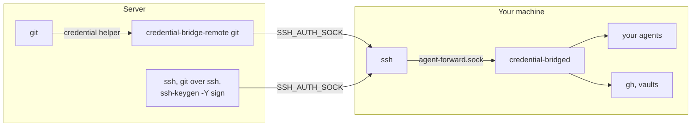

# credential-bridge

**One ssh agent for your keys, your git tokens and gpg, on every server you log in to.**

<table>
<tr><th>On a server you added</th><th>On every other server</th></tr>
<tr><td>

```console
you@laptop:~$ ssh buildserver
me@buildserver:~$ git clone https://github.com/my-org/private-repo
Cloning into 'private-repo'...
me@buildserver:~$ git commit -S -m "fix: retry on 502"
[main 4e1c2a9] fix: retry on 502
```

No token pasted, nothing written to the server's disk. The commit is signed by the
YubiKey on your laptop.

</td><td>

```console
you@laptop:~$ ssh shared-jumphost
me@shared-jumphost:~$ ssh-add -l
The agent has no identities.
me@shared-jumphost:~$ git clone https://github.com/my-org/private-repo
Username for 'https://github.com':
```

Agent forwarding is on, yet this server gets no keys, no tokens and no gpg. It cannot
even tell that a bridge is there.

</td></tr>
</table>

credential-bridge is a local ssh-agent proxy. You point ssh at it, forward it like any
agent, and every server you connect to can then use your ssh keys, get git tokens for
HTTPS remotes and reach your gpg-agent, each within the profile you gave that server.
Nothing secret is stored on a server: git asks `credential-bridge-remote`, which asks
the agent channel of the ssh session, and the daemon on your laptop recognises the
server by its host key, checks its profile and answers.

<!-- prettier-ignore -->
> [!WARNING]
> **credential-bridge is beta (0.x).** Version 0.2 is a rewrite as an agent proxy and
> has seen little real-world use yet. It is covered by unit and integration tests, the
> remote binaries under qemu, fuzzing, and an end-to-end test with real ssh agent
> forwarding and git over HTTPS in four VMs, but:
>
> - macOS is only partly type-checked and not yet tested on a real Mac.
> - The aarch64 and s390x remote binaries have only run under emulation.
> - 1Password, Bitwarden and hardware keys have not been tested against the real tools
>   yet; KeePassXC only with keepassxc-cli 2.8.0 on Linux and a database without key file
>   (see [Still to verify](docs/architecture.md#still-to-verify)).
> - Release packages are not code-signed; check them against `SHA256SUMS` and their
>   [build provenance](#verifying-a-release-package).
> - Configuration and protocol may still change between 0.x versions.
>
> Try it on a test server first and please [report what you run into](https://github.com/XeS0r/ssh-credential-bridge/issues).

## Try it in five minutes

No real server needed: with Nix on Linux, a throwaway VM plays the server. Every start
is a fresh machine.

```sh
git clone https://github.com/XeS0r/ssh-credential-bridge && cd ssh-credential-bridge
nix run .#vm      # the server: 127.0.0.1:2222, user test, password test (quit: Ctrl-A X)
```

In a second terminal, add it to `~/.ssh/config` (for a real server,
`credential-bridge-ctl server ssh-config` suggests the `ForwardAgent` line):

```text
Host testbox
    HostName 127.0.0.1
    Port 2222
    User test
    HostKeyAlias testbox
    ForwardAgent ~/.local/state/credential-bridge/agent-forward.sock
```

Copy your ssh key to it, so the password is asked only once:

```sh
ssh-copy-id testbox      # password: test
```

Then set up the bridge and send your gh login to the VM:

```sh
# Build the daemon, ctl and the server binaries and link them into ~/.local (no root)
nix run .#install

# Write ~/.config/credential-bridge/config.toml: finds your ssh agents and a gh login,
# asks about each (--yes takes the proposal as it is)
credential-bridge-ctl init

# A profile says what a server may use: "dev" for your development servers,
# which see every key of every agent
credential-bridge-ctl profile add dev ssh.keys=all

# ... and get GitHub tokens from your gh login, only for your own repositories
credential-bridge-ctl profile rule add dev 'https://github.com/<you>/*' --source github

# Run the daemon as a user service (systemd); it opens the proxy sockets
credential-bridge-ctl daemon install

# Register the VM by its known_hosts entry, install credential-bridge-remote there,
# set up its git, give the server the profile, and probe the result
credential-bridge-ctl server add testbox --profile dev

# git on the VM asks the bridge for the token; nothing is stored there
ssh testbox git clone https://github.com/<you>/<private-repo>
```

The VM never saw a token. Run `ssh testbox ssh-add -l`, then
`credential-bridge-ctl server remove testbox` and run it again: the keys are gone. After
a restart the VM is new again, with a new host key: run `ssh-keygen -R testbox` and
`ssh-copy-id testbox` (ssh stores the new key in known_hosts, which the bridge follows),
then `server add` again to install credential-bridge-remote on the fresh VM.

## What it does

- **Several agents behind one socket.** 1Password, Bitwarden, OpenSSH's `ssh-agent`
  (also with FIDO2 `-sk` keys), gpg-agent with an OpenPGP card, Secretive: the proxy
  merges their keys and sends each signature to the agent that holds the key, unchanged.
- **A profile per server.** Servers are recognised by their host key, which OpenSSH 8.9
  or later sends with every forwarded agent connection (`session-bind@openssh.com`): the
  key ssh keeps for the server in known_hosts, followed when it changes, or a pinned
  one. A host certificate counts by the host key inside it; a server ssh trusts only
  through `@cert-authority` or a wildcard line is added with `--pin`. The profile
  decides which keys the server sees, whether signatures need your approval, which git
  tokens it gets and whether it may use gpg.
- **Secure by default.** A server you have not added gets no keys (not even public ones
  that would identify you), no tokens and no gpg, and cannot tell that a bridge is
  there; behind an older or another ssh client every server gets nothing. Your machine
  logs every such attempt, and `ctl check` lists them.
- **git tokens on demand.** From `gh`, from an existing git credential helper, or from a
  vault (1Password, Bitwarden, KeePassXC, macOS Keychain, Secret Service, pass, a
  command). GitHub App tokens are minted per request with exactly the rights of the
  rule. Tokens never touch the server's disk.
- **gpg** for `pass`, `sops` and decryption on the server, filtered to signing or
  decrypting. For git commits, use ssh signing; the profile can set it up.
- **Many sessions, many people.** Everything travels through the agent channel sshd
  creates for each session, so several sessions and several people in one account each
  reach their own laptop. Someone without a bridge simply falls through to their own git
  helper and gpg-agent.

## How it compares

|                                     | Token on the server<br/>(`gh auth login`, PAT) | plain agent forwarding |              **credential-bridge**               |
| ----------------------------------- | :--------------------------------------------: | :--------------------: | :----------------------------------------------: |
| Nothing secret on the server's disk |                       ✗                        |           ✓            |                      **✓**                       |
| git over HTTPS                      |                       ✓                        |   ✗ (ssh URLs only)    |                      **✓**                       |
| Several agents (1Password + FIDO2)  |                       –                        |           ✗            |                      **✓**                       |
| Different keys per server           |                       –                        |           ✗            |                      **✓**                       |
| Approval dialog per server and key  |                       –                        |  per key (`ssh-add`)   |                      **✓**                       |
| gpg on the server                   |                       –                        |           ✗            |              **✓** (sign / decrypt)              |
| Every request in one log            |                       ✗                        |           ✗            |                      **✓**                       |
| Something to install on the server  |                       gh                       |           –            | one static binary, installed by `ctl server add` |

## Get started

**You need:** Linux (macOS should work but is not yet tested on a real Mac), OpenSSH 8.9
or later (required to recognise servers; `ctl check` warns about an older `ssh`). **The
server needs:** Linux, sshd with agent forwarding allowed (the default), and git if you
want tokens.

**1. Install it on your machine**, either way:

<table>
<tr><th>Without Nix (Linux)</th><th>With Nix (Linux; macOS untested)</th></tr>
<tr><td>

Download `credential-bridge-<version>-x86_64-linux.tar.gz` (or `aarch64`) from the
[latest release](https://github.com/XeS0r/ssh-credential-bridge/releases/latest), then:

```sh
tar xzf credential-bridge-*.tar.gz
./credential-bridge-*/install.sh
```

Static binaries, no dependencies, no root. Installs into `~/.local`.

</td><td>

No checkout needed:

```sh
nix run github:XeS0r/ssh-credential-bridge#install
```

Builds everything reproducibly and links it into `~/.local`. From a checkout:
`nix run .#install`.

</td></tr>
</table>

**2. Write the configuration with `ctl init`.** It looks for your agents
(`SSH_AUTH_SOCK`, the 1Password agent, gpg-agent's ssh socket) and a logged-in `gh`,
shows what it found and asks about each item (accept, change, skip); `--yes` takes the
proposal as it is:

```console
$ credential-bridge-ctl init
Proposal for ~/.config/credential-bridge/config.toml:
✓ agent ssh-agent      ~/.ssh/agent.sock (SSH_AUTH_SOCK)
✓ agent 1password      ~/.1password/agent.sock (1Password)
✓ add_to               ssh-agent (ssh-add through the proxy goes here)
✓ source github        gh is logged in to github.com
agent ssh-agent at ~/.ssh/agent.sock: (a)ccept, (c)hange, (s)kip? [a]
…
✓ config               written in ~/.config/credential-bridge/config.toml
```

Then say what a server may use, in a **profile** with git rules:

```sh
credential-bridge-ctl profile add dev ssh.keys=all signing=ssh
credential-bridge-ctl profile rule add dev 'https://github.com/my-org/*' --source github
```

Every command that changes the file validates the result the way the daemon loads it,
keeps your comments, writes atomically and reloads a running daemon; `--dry-run` prints
the change as a diff instead. The file stays yours to edit by hand
(`credential-bridge-ctl config edit` checks it before saving);
[Configuration](#configuration) shows the whole format and the commands for each part.
Servers you have not added get nothing; there is no need to write anything for that.

Then start the daemon (systemd user service on Linux, launchd on macOS, untested):

```sh
credential-bridge-ctl daemon install
```

**3. Add a server.** Connect to it once with `ssh buildserver` and confirm its host key,
so that ssh stores it in known_hosts. `server add` then registers the server by that
known_hosts entry, installs `credential-bridge-remote` in the server account, sets up
git there and finally probes the whole chain through the daemon:

```console
$ credential-bridge-ctl server add buildserver --profile dev
✓ host key             ssh-ed25519 SHA256:3f9K… (used by ssh)
✓ known_hosts          buildserver: ssh-ed25519, ssh-rsa (followed)
✓ remote installed     credential-bridge-remote 0.2.0
✓ config               [server.buildserver] in ~/.config/credential-bridge/config.toml
✓ daemon               reloaded the configuration
✓ git config           github.com, ssh signing set up
⚠ ssh config           no ForwardAgent to the proxy for buildserver
                       → credential-bridge-ctl server ssh-config buildserver
✓ probe                the daemon recognises buildserver (profile dev)
```

The bridge follows known_hosts: when the server's host key changes and ssh learns the
new one, the server stays recognised without running `server add` again. ssh learns new
keys at login through `UpdateHostKeys`, which is on by default but off when
`UserKnownHostsFile` is set or `VerifyHostKeyDNS` is on (`server add` says so); then a
changed key is followed once you accept it in ssh. Following also means that a host key
you accept for the server's name in ssh (also through
`StrictHostKeyChecking accept-new`) gives that host the server's profile at once.
`server add buildserver --profile dev --pin` pins the keys known_hosts lists now
instead; a server ssh trusts only through a wildcard line or a host certificate
(`@cert-authority`) needs `--pin`, which pins the key ssh used (for a certificate the
key in it, fetched with `ssh-keyscan` and checked against it), provided ssh verified it
against known_hosts; with `StrictHostKeyChecking no` it did not, and nothing is pinned
([when to pin](docs/architecture.md#host-keys-known_hosts-or-pinned)). Running
`server add` again is safe: it keeps the server's mode, and a pinned server keeps its
pinned keys (if ssh used another key, it stops before installing anything); `--pin` pins
again with the keys known_hosts lists now, `--follow` makes a pinned server follow
known_hosts again.

**4. Point ssh at the proxy.** `~/.ssh/config` stays yours; ctl prints a suggestion:

```sh
credential-bridge-ctl server ssh-config buildserver
```

```text
Host *
  IdentityAgent ~/.local/state/credential-bridge/agent.sock

Host buildserver
  ForwardAgent ~/.local/state/credential-bridge/agent-forward.sock
```

`credential-bridge-ctl server ssh-config --fallback ~/.1password/agent.sock` prints a
variant with `Match exec "credential-bridge-ctl daemon alive"` that falls back to
another agent when the daemon is not running.

**5. Check, and go:** `check` looks at your machine; with a server name it also probes
that server and its git setup (`--all` for every server).

```sh
credential-bridge-ctl check buildserver
ssh buildserver
git clone https://github.com/my-org/private-repo    # on buildserver
```

Every server after that is step 3 and the `Host` line of step 4 again.

## Tokens from the vault you already use

ctl writes only a reference into the config. The vault is asked on your machine when a
server needs a token, and git on the server uses it for one call and forgets it.

| Vault                                   | Reference                               |
| --------------------------------------- | --------------------------------------- |
| 1Password                               | `op://Dev/github-pat/credential`        |
| Bitwarden                               | `bw://gitlab-team/token`                |
| KeePassXC                               | `keepassxc://Dev/forgejo/password`      |
| macOS Keychain                          | `keychain://github.corp.example/ci-bot` |
| Secret Service (GNOME Keyring, KWallet) | `secret-service://service=gitea`        |
| pass                                    | `pass://dev/codeberg-token`             |
| any command                             | `cmd:my-token-script --org my-org`      |

```sh
# 1Password: a GitHub fine-grained token
credential-bridge-ctl source add github work --auth pat --token op://Dev/github-pat/credential

# Bitwarden: a GitLab token
credential-bridge-ctl source add gitlab team --host gitlab.example.com --token bw://gitlab-team/token

# KeePassXC: a Forgejo token
credential-bridge-ctl source add forgejo home --host git.example.org --token keepassxc://Dev/forgejo/password

# macOS Keychain: a token for GitHub Enterprise
credential-bridge-ctl source add github corp --auth pat --host github.corp.example --token keychain://github.corp.example/ci-bot

# Secret Service (GNOME Keyring, KWallet): a Gitea token
credential-bridge-ctl source add gitea lab --host gitea.example.net --token secret-service://service=gitea

# pass: a Codeberg token
credential-bridge-ctl source add forgejo codeberg --host codeberg.org --token pass://dev/codeberg-token

# any command that prints the token
credential-bridge-ctl source add gitlab ops --host gitlab.ops.example --token 'cmd:my-token-script --org my-org'
```

`source add` tests the new reference right away through the daemon and warns if it does
not resolve yet (vault locked, item not found, tool missing); the entry is written
either way. The secret never reaches ctl.

```sh
# Which vaults the sources use, their state and what to do next
credential-bridge-ctl vault list

# KeePassXC through keepassxc-cli: asks for the .kdbx file (and a key file), then offers
# to restart the daemon and to unlock
credential-bridge-ctl vault setup keepassxc

# Does the reference of source "work" resolve? Says why not, never shows the secret
credential-bridge-ctl source test work
```

The bridge never asks for a password itself. 1Password and pass show their own approval
(the desktop app, gpg-agent's pinentry); Bitwarden and KeePassXC with a database file
are unlocked with `credential-bridge-ctl vault unlock`. Only KeePassXC has settings;
`vault setup` on any other vault says why it needs none. No vault at all? `gh` (the
default for GitHub) or any git credential helper works too:
`credential-bridge-ctl source add helper corp --helper manager`.

## How it works



1. ssh forwards `agent-forward.sock` into each session. For every agent connection from
   the server it first tells the proxy which server this is, signed by the server's host
   key. Only this first message counts; what the server sends later cannot change it.
2. Signatures go unchanged to the agent that holds the key. Key lists are filtered by
   the server's profile.
3. git tokens and gpg travel as agent protocol extensions. The daemon checks the
   profile, gets the token in a separate worker process and sends it back. git uses it
   once and forgets it.

The local socket `agent.sock` is for your own logins and `ssh-add`; it never hands out
tokens. [docs/architecture.md](docs/architecture.md) describes the implementation and
the reasons behind it.

## Everyday use

| You want to …                       | Run                                                                                                  |
| ----------------------------------- | ---------------------------------------------------------------------------------------------------- |
| see all servers and their profiles  | `credential-bridge-ctl server list`, `server show NAME`                                              |
| see the whole configuration         | `credential-bridge-ctl config show` (built-in values marked)                                         |
| apply a config edited by hand       | `credential-bridge-ctl daemon reload` (`[daemon]`, `[vault]`: `daemon stop`, `daemon start`)         |
| let a server sign only after asking | `credential-bridge-ctl profile set dev ssh.confirm=8h`                                               |
| give a server another profile       | `credential-bridge-ctl server set NAME --profile build`                                              |
| see the keys a server gets          | `credential-bridge-ctl server keys NAME`                                                             |
| test which token a URL would get    | `credential-bridge-ctl server token NAME https://github.com/my-org/app`                              |
| see what was asked and answered     | `credential-bridge-ctl log -f`                                                                       |
| find out why something doesn't work | `credential-bridge-ctl check`, `check NAME` or `check --all` (servers)                               |
| follow a server's new host key      | nothing to do once ssh knows it (`ssh NAME`); pinned: `server add`                                   |
| see the vaults and what to do next  | `credential-bridge-ctl vault list`, `vault show NAME`                                                |
| test the secret of a source         | `credential-bridge-ctl source test NAME` (never shows the secret)                                    |
| use a KeePassXC database file       | `credential-bridge-ctl vault setup keepassxc` (`vault forget keepassxc` undoes it)                   |
| unlock Bitwarden for 8 hours        | `credential-bridge-ctl vault unlock bitwarden`                                                       |
| create a GitHub App for an org      | `credential-bridge-ctl source add github NAME --auth app --create --org my-org --private-key op://…` |
| use gpg on a server                 | `credential-bridge-ctl gpg setup NAME` prints what to add there                                      |
| lock a vault again                  | `credential-bridge-ctl vault lock bitwarden` (`--all` for every vault), drops its cached tokens      |
| lock every key for a moment         | `ssh-add -x` (and `ssh-add -X` to unlock)                                                            |
| remove a server again               | `credential-bridge-ctl server remove NAME --remote`                                                  |
| clean up a host without an entry    | `credential-bridge-ctl server uninstall user@host`                                                   |
| update credential-bridge            | the new release's `install.sh`, or `nix run …#install` again                                         |

Problems show up where you see them, also in git's output on the server:

```text
credential-bridge: vault bitwarden is locked: run credential-bridge-ctl vault unlock bitwarden
```

## Configuration

`~/.config/credential-bridge/config.toml`. Five terms, from the outside in: a **server**
has a **profile**; the profile says what is allowed and holds **git rules**; a rule
points to a **source**; the source takes secrets from a **vault reference**. Every part
can be changed with ctl or by hand: ctl keeps your comments, writes only references to
secrets, never the secrets, and writes nothing that does not validate.

```toml
version = 2

[agent]
add_to = "fido"

[[agent.upstream]]
name   = "1password"
socket = "~/.1password/agent.sock"

[[agent.upstream]]
name   = "yubikey"                          # OpenPGP card via gpg-agent
socket = "gpgconf:agent-ssh-socket"

[[agent.upstream]]
name   = "fido"                             # ed25519-sk keys in ssh-agent
socket = "~/.ssh/agent.sock"

[gpg]                                       # only needed if a profile allows gpg
socket = "gpgconf:agent-extra-socket"

[source.github]
type = "github"
auth = "gh"

[source.my-org]                             # written by `ctl source add github --auth app --create`
type            = "github"
auth            = "app"
app_id          = 123456
private_key     = "op://Dev/bridge-app/private-key"
max_permissions = { contents = "write", pull_requests = "write" }

[source.gitlab]
type  = "gitlab"
host  = "gitlab.example.com"
token = "bw://gitlab-team/token"

[profile.build]
ssh  = { keys = ["yubikey"] }               # only these upstreams are visible
gpg  = ["sign"]                             # sign yes, decrypt no
hops = { ssh = true, git = false, gpg = false }

[[profile.build.git]]
url         = "https://github.com/my-org/*"
source      = "my-org"
permissions = { contents = "write" }        # one token per repository

[[profile.build.git]]
url    = "https://gitlab.example.com/team/*"
source = "gitlab"

[profile.dev]
ssh     = { keys = "all", confirm = "8h" }  # approval dialog, remembered 8 hours
signing = "ssh"

[[profile.dev.git]]
url    = "https://github.com/*"
source = "github"

# Servers without an entry: the built-in profile.unregistered, no keys,
# no tokens, no gpg. Nothing to write; to loosen it on purpose:
# [profile.unregistered]
# ssh = { keys = ["fido"], confirm = "8h" } # dialog, remembered per host key

[server.buildserver]                        # written by `ctl server add`
known_host = "buildserver"                  # its host keys in known_hosts
profile    = "build"
```

| Setting                       | Meaning                                                                                                                                                                                                                                                                                                  |
| ----------------------------- | -------------------------------------------------------------------------------------------------------------------------------------------------------------------------------------------------------------------------------------------------------------------------------------------------------- |
| `[daemon]`                    | `socket`, `forward_socket`, `control_socket`, `audit_log`; defaults under `~/.local/state/credential-bridge/`                                                                                                                                                                                            |
| `[[agent.upstream]]`          | a real agent: a path, or `gpgconf:<socket name>`; without `[agent]` the proxy only hands out tokens                                                                                                                                                                                                      |
| `source.*.type`               | `github` (`auth = "gh"`, `"pat"`, `"app"`), `gitlab`, `forgejo`, `gitea`, `helper` (any git credential helper, e.g. `helper = "manager"`)                                                                                                                                                                |
| `source.*.cache`              | `true` (default): tokens of `pat`, `app`, `gitlab`, `forgejo`, `gitea` sources stay in the bridge until `erase`, a lock or a reload changing the source; `false` (`source add … --no-cache`): each git request reads the vault (1Password: an approval each time) or mints an App token                  |
| vault references              | see [Tokens from the vault you already use](#tokens-from-the-vault-you-already-use)                                                                                                                                                                                                                      |
| `[vault.keepassxc]`           | `database` and optional `key_file` (written by `ctl vault setup keepassxc`): KeePassXC through `keepassxc-cli` after `ctl vault unlock keepassxc`; required on macOS (Linux without it: the running app)                                                                                                 |
| `profile.*.ssh`               | `keys = "all"`, a list of upstream names, or `[]`; `confirm = "never"` (default), `"always"` (a dialog for every signature) or a duration such as `"8h"` (a dialog per server, key and local process, remembered that long)                                                                              |
| `[profile.unregistered]`      | built in for servers without an entry: `ssh = { keys = [], confirm = "always" }`, all hops off, never git rules, gpg or signing; fields you write override it (`keys` is required with `ssh`)                                                                                                            |
| `profile.*.hops`              | what hosts behind the server may use; default `{ ssh = true, git = false, gpg = false }`, like plain agent forwarding                                                                                                                                                                                    |
| `profile.*.git`               | rules in order, first match wins: `url`, `source`, and for GitHub Apps `permissions` and `per = "repo"` (default) or `"owner"`                                                                                                                                                                           |
| `server.*.known_host`         | the server's name in known_hosts (`HostKeyAlias`, else the host name, `[host]:port` for another port), lowercase; its keys there are followed. `known_hosts_files` when ssh reads other files than `~/.ssh/known_hosts{,2}` and `/etc/ssh/ssh_known_hosts{,2}` (Homebrew's ssh: `/opt/homebrew/etc/ssh`) |
| `server.*.host_keys`          | instead of `known_host`: pinned host keys (`server add --pin`)                                                                                                                                                                                                                                           |
| `server.*.git_config = false` | ctl leaves the git config on that server alone and prints the lines instead (`server add --no-git-config`)                                                                                                                                                                                               |

The commands for each part (`ctl` is `credential-bridge-ctl`):

| Part                            | Commands (each with `--dry-run`)                                                                             |
| ------------------------------- | ------------------------------------------------------------------------------------------------------------ |
| a new file                      | `ctl init`                                                                                                   |
| the whole file                  | `ctl config show` (with built-in values), `config path`, `config check`, `config edit`                       |
| `[daemon]`                      | `ctl daemon set --audit-log PATH` (sockets and log change when the daemon restarts)                          |
| `[agent]`, `[[agent.upstream]]` | `ctl agent add NAME SOCKET [--add-to]`, `agent list`, `agent set --add-to NAME`, `remove`                    |
| `[source.*]`                    | `ctl source add github\|gitlab\|forgejo\|gitea\|helper NAME …`, `list`, `show`, `remove`                     |
| a new GitHub App and its source | `ctl source add github NAME --auth app --create --private-key REFERENCE` (no `--dry-run`)                    |
| `[profile.*]`                   | `ctl profile add NAME [KEY=VALUE…]`, `list`, `show`, `set NAME KEY=VALUE…`, `remove`                         |
| `[[profile.*.git]]`             | `ctl profile rule add PROFILE URL --source NAME [--permission …] [--per owner]`, `remove`                    |
| `[profile.unregistered]`        | `ctl profile set unregistered ssh.keys=… ssh.confirm=… hops.ssh=…`                                           |
| `[server.*]`                    | `ctl server add NAME --profile P [--pin\|--follow]`, `server set NAME --profile P`, `list`, `show`, `remove` |
| `[vault.keepassxc]`             | `ctl vault setup keepassxc [--database PATH]` (asks, offers restart and unlock), `vault forget`              |
| `[gpg]`                         | `ctl gpg set --socket SOCKET`, `remove`                                                                      |

Removing what something else still uses (a profile a server has, a source a rule names,
an agent `add_to` or a profile names) is refused with the command that fixes it.
`credential-bridge-ctl check` validates everything and names each problem with its place
in the file. A configuration file of 0.1 is rejected with a clear message; there is no
automatic migration.

## Questions

<details>
<summary><b>Is it safe?</b></summary>

Tokens and keys stay on your machine. Servers get only what their profile allows, and a
server is recognised by its host key, not by anything it says about itself (this needs
OpenSSH 8.9 or later on your machine). A server you have not added gets nothing and sees
an agent without the bridge. Only your own user can talk to the daemon. The parts that
handle tokens and gpg run as separate processes in a sandbox (Landlock and seccomp on
Linux). The honest limit is the same as with agent forwarding: while your session is
open, someone with your account or root on that server can use the session's agent
socket, within its profile. Details: [security](docs/architecture.md#security-rules).
Found a vulnerability? Please report it privately, see [SECURITY.md](SECURITY.md).

</details>

<details>
<summary><b>What happens when I'm not connected, or someone else uses the account?</b></summary>

Nothing breaks. Without a bridge on `SSH_AUTH_SOCK`, `credential-bridge-remote git`
answers nothing, so git carries on with the next helper or its prompt. The gpg shim
hands such callers to a real gpg-agent.

</details>

<details>
<summary><b>Why does a server I have not added see no keys?</b></summary>

On purpose: an unknown server should not even learn your public keys, which would
identify you across servers. Your machine logs the attempt with the server's host key,
and `credential-bridge-ctl check` lists recent ones with the hint to run
`credential-bridge-ctl server add NAME --profile PROFILE`. To let unknown servers use
some keys anyway, loosen the built-in profile on purpose; a dialog then asks for every
signature, or once per server and duration:

```toml
[profile.unregistered]
ssh = { keys = ["fido"], confirm = "8h" }
```

Tokens and gpg are only ever given to servers you have added.

</details>

<details>
<summary><b>Do hardware keys work?</b></summary>

Yes, without special code: touch and PIN always happen on your machine. FIDO2 keys
(`ed25519-sk`) through OpenSSH's `ssh-agent`, OpenPGP cards through gpg-agent's ssh and
extra sockets, PIV through `ssh-agent` with PKCS#11, Secure Enclave keys through
Secretive.

</details>

<details>
<summary><b>Which servers are supported?</b></summary>

Linux on x86_64, aarch64 and s390x (IBM Z), with agent forwarding allowed.
`credential-bridge-remote` is one static binary; `server add` detects the platform and
installs the right one into `~/.local/bin`. Your own machine can be Linux (release
package or Nix) or, not yet tested on a real Mac, macOS (Nix or cargo). Windows is not
supported yet; WSL works.

</details>

<details>
<summary><b>Why is a push that changes <code>.github/workflows</code> refused?</b></summary>

GitHub only accepts changes to workflow files from tokens allowed to change workflows,
and refuses the whole push otherwise
(`refusing to allow an OAuth App to create or update workflow … without workflow scope`).
For a `gh` source, add the scope to the login on your machine:
`gh auth refresh -h github.com -s workflow`. A fine-grained PAT needs the repository
permission "Workflows: write"; for a GitHub App source, add `workflows = "write"` to the
rule's `permissions` (and to the source's `max_permissions`).

</details>

<details>
<summary><b>Can I set up a server by hand?</b></summary>

Yes. Copy `credential-bridge-remote` for its platform (in a release package under
`share/credential-bridge/helpers/`, or
`nix build .#credential-bridge-remote-x86_64-unknown-linux-musl`) to
`~/.local/bin/credential-bridge-remote` on the server, run
`credential-bridge-remote setup --host github.com` there, and write `[server.NAME]`
yourself with `known_host = "NAME"` (the server's name in your known_hosts) or
`host_keys`. `credential-bridge-remote query` tells you whether the current
`SSH_AUTH_SOCK` leads to the proxy.

</details>

<details>
<summary><b>Coming from 0.1?</b></summary>

Remove 0.1 first, then follow [Get started](#get-started); nothing is migrated. The
steps are under 0.2.0 in the [changelog](CHANGELOG.md). The installers refuse to install
over 0.1 until it is removed, and `ctl check` warns about a 0.1 service left behind.

</details>

## Reference

### Programs

| Program                    | Where          | What it is                                                                                                        |
| -------------------------- | -------------- | ----------------------------------------------------------------------------------------------------------------- |
| `credential-bridged`       | your machine   | the daemon: agent proxy, policy, audit log; starts its workers on demand                                          |
| `credential-bridge-ctl`    | your machine   | `init`, `check`, `log`, `config`, `completions`, `agent`, `source`, `profile`, `server`, `vault`, `gpg`, `daemon` |
| `credential-bridge-remote` | on each server | `git` (credential helper), `gpg` (gpg shim), `setup`, `uninstall`, `query`                                        |

Every command has `--help`; man pages and bash, zsh and fish completions come with the
install. The audit log is `~/.local/state/credential-bridge/audit.log` on Linux and
`~/Library/Logs/credential-bridge/audit.log` on macOS.

### Install details

| Way                 | What it does                                                                                                                                                                                                                                                                                                                           | Remove                                                 |
| ------------------- | -------------------------------------------------------------------------------------------------------------------------------------------------------------------------------------------------------------------------------------------------------------------------------------------------------------------------------------- | ------------------------------------------------------ |
| Release package     | `install.sh` copies the static programs, `credential-bridge-remote` for every server platform, man pages and completions into `~/.local` (`--prefix DIR` for another place). Running a newer package's `install.sh` updates and restarts the service.                                                                                  | `install.sh --uninstall`                               |
| Nix                 | `nix run github:XeS0r/ssh-credential-bridge#install` (from a checkout `nix run .#install` or `just install`) builds everything, protects it from garbage collection with a root in `~/.local/share/credential-bridge/package` and links it into `~/.local` (`PREFIX` changes that). Running it again updates and restarts the service. | `nix run github:XeS0r/ssh-credential-bridge#uninstall` |
| From source (cargo) | `cargo install --locked --path crates/ctl` and `--path crates/daemon` build the local programs. Servers need a static `credential-bridge-remote`: take it from a release package and put it into `~/.local/share/credential-bridge/helpers/`, or pass `server add --remote-binary PATH`.                                               | `cargo uninstall …`                                    |

Your configuration in `~/.config/credential-bridge/` is never touched. Release packages
are built by `nix build .#release` and are reproducible.

### Verifying a release package

The release workflow builds a package only from a tagged commit on `main` that passed
the checks, and attests its build provenance with GitHub (Sigstore). With the
[GitHub CLI](https://cli.github.com/), check that a downloaded package was built by this
repository's release workflow:

```sh
gh attestation verify credential-bridge-<version>-x86_64-linux.tar.gz \
  --repo XeS0r/ssh-credential-bridge \
  --signer-workflow XeS0r/ssh-credential-bridge/.github/workflows/release.yml
sha256sum --check --ignore-missing SHA256SUMS
```

`SHA256SUMS` is attested as well. The attestation says which workflow run and commit
built the file; it is not a code signature of the programs.

## Development

Everything runs through Nix; `nix develop` (or direnv) gives you the toolchain and
`just`.

```sh
just test          # unit and integration tests
just e2e           # four VMs: real agent forwarding, git over HTTPS, FIDO2 via sk-dummy
just fuzz 60       # every fuzz target for 60 seconds (nightly comes from the flake)
just links         # lychee over every Markdown file, external links and anchors
                   # included (nix run .#links; `-- --offline` for local ones only)
just check         # everything CI runs: build, tests, clippy (Linux + macOS), rustfmt,
                   # Markdown, local links, remote binaries under qemu, release
                   # package, fuzz, e2e
just vm            # a throwaway server to try it by hand (sshd on 127.0.0.1:2222, test/test)
```

[Try it in five minutes](#try-it-in-five-minutes) walks through a session against the
throwaway server.

The VM tests need KVM. Nix builds do not get the kvm group (a proposed option,
[NixOS/nix#13314](https://github.com/NixOS/nix/pull/13314), is not merged), so
`/dev/kvm` must be mode 0666, as upstream systemd sets by default
([`meson_options.txt`](https://github.com/systemd/systemd/blob/main/meson_options.txt));
Debian and Ubuntu ship 0660. Otherwise the VMs fall back to slow emulation (`just e2e`
and `just check` warn). A udev rule fixes it:

```sh
# /etc/udev/rules.d/99-kvm.rules
KERNEL=="kvm", GROUP="kvm", MODE="0666", OPTIONS+="static_node=kvm"
```

then `sudo udevadm control --reload-rules && sudo udevadm trigger --name-match=kvm`.

| Crate             | What it is                                                                       |
| ----------------- | -------------------------------------------------------------------------------- |
| `crates/proto`    | wire formats: agent protocol, session-bind, extensions, worker IPC, git's format |
| `crates/config`   | configuration schema, validation, paths, format-preserving edits                 |
| `crates/platform` | peer credentials, hardening, sandbox, worker channel, sockets, dialogs, services |
| `crates/gpg`      | Assuan parsing and the command filter for the gpg bridge                         |
| `crates/vault`    | vault references, `gh` and git credential helpers                                |
| `crates/forge`    | GitHub App tokens, PAT, GitLab and Forgejo tokens                                |
| `crates/daemon`   | `credential-bridged`                                                             |
| `crates/ctl`      | `credential-bridge-ctl`                                                          |
| `crates/remote`   | `credential-bridge-remote`, the static binary for servers                        |

## License

[MIT](LICENSE)
