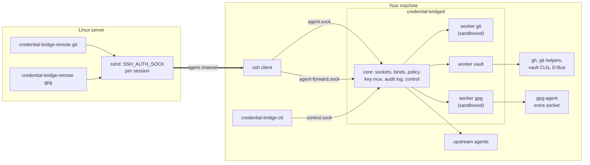
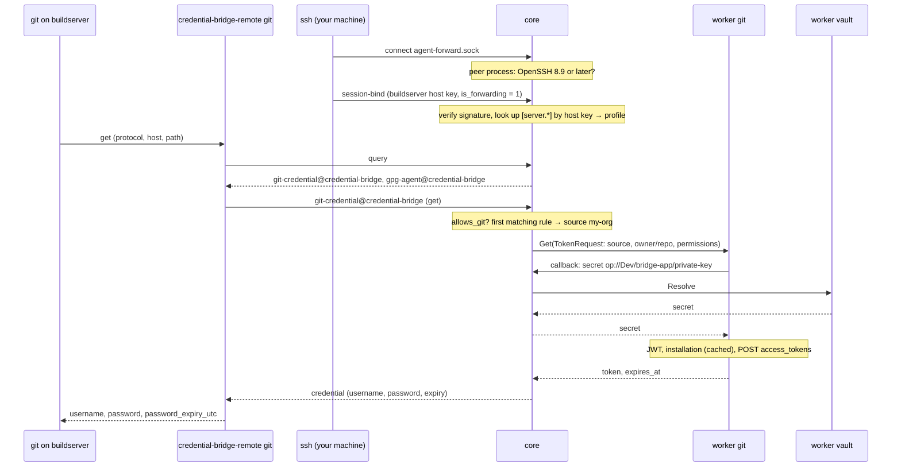
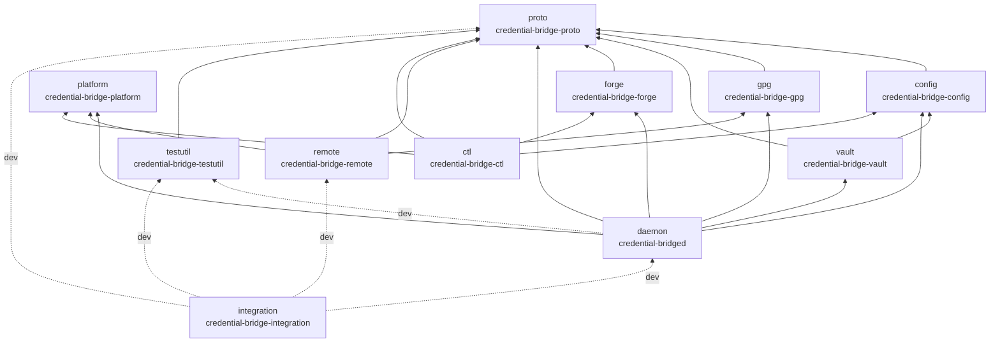

# Architecture

This document describes credential-bridge as it is implemented: the processes, what
happens to a request, each building block and the reasons behind it, the crates, the
configuration, the security rules, the limitations and the decisions that shaped it. The
public interface of each crate is documented in its rustdoc (`cargo doc --workspace`).

- [Overview](#overview)
- [Processes](#processes)
- [A connection, end to end](#a-connection-end-to-end)
- [Two sockets](#two-sockets)
- [Recognising the server](#recognising-the-server)
- [Hops](#hops)
- [Agent proxy and key mux](#agent-proxy-and-key-mux)
- [Extensions](#extensions)
- [git tokens](#git-tokens)
- [Vaults](#vaults)
- [gpg](#gpg)
- [Approvals and locking](#approvals-and-locking)
- [ssh configuration](#ssh-configuration)
- [The remote side](#the-remote-side)
- [ctl](#ctl)
- [Wire formats](#wire-formats)
- [Crates and allowed dependencies](#crates-and-allowed-dependencies)
- [Build, packaging and tests](#build-packaging-and-tests)
- [Configuration](#configuration)
- [Security rules](#security-rules)
- [Limitations](#limitations)
- [Still to verify](#still-to-verify)
- [Decisions](#decisions)

## Overview

credential-bridge is a local ssh-agent proxy. ssh uses it as `IdentityAgent` and
forwards it with `ForwardAgent`. On the server, everything that talks to `SSH_AUTH_SOCK`
reaches the proxy through the agent channel sshd creates for that session: ssh
signatures, git tokens (an agent extension) and gpg (another extension). Several
sessions and several people in one remote account therefore each reach their own daemon.
Every building block is optional: nothing that is not configured starts or needs a tool.



Four ways through the proxy:

1. **Your own login.** ssh asks the proxy on `agent.sock` (as `IdentityAgent`); the key
   mux picks the agent that holds the key.
2. **A signature on the server** (git over ssh, a further ssh, `ssh-keygen -Y sign`).
   The request runs through the session's agent channel to `agent-forward.sock` and on,
   unchanged, to the agent that holds the key.
3. **An HTTPS token.** git on the server calls `credential-bridge-remote git`, which
   sends the `git-credential@credential-bridge` extension over `SSH_AUTH_SOCK`. The core
   recognises the server, checks its profile and asks the git worker.
4. **gpg.** The shim on the server tunnels the Assuan protocol over
   `gpg-agent@credential-bridge` to the extra socket of your local gpg-agent.

## Processes

```text
credential-bridged run         core: the only process with the sockets
 ├─ credential-bridged worker git     GitHub/GitLab/Forgejo tokens; Landlock + seccomp
 ├─ credential-bridged worker vault   runs gh, git helpers, vault CLIs; no sandbox
 └─ credential-bridged worker gpg     filters Assuan; no file system, no sockets
```

- **Core** (`crates/daemon`, `core.rs`, `connection.rs`). A tokio runtime. At start it
  hardens the process (`PR_SET_DUMPABLE=0` or `PT_DENY_ATTACH`, no core dumps), loads
  the configuration, resolves `gpgconf:` sockets and binds three sockets in a private
  directory (mode 0700, sockets 0600): `agent.sock`, `agent-forward.sock` and
  `control.sock`. Every connection is checked with `SO_PEERCRED` / `getpeereid`; only
  the own user and root are accepted, at most 256 connections per socket. On
  `agent-forward.sock` a server's connections (counted by the host key of their server
  bind, a verified forwarding bind that is the connection's first message; all
  connections without one together) get at most 64 of them, connections idle for 10
  minutes are closed, and the rest of a request must arrive within 30 seconds of its
  first byte. `SIGHUP` reloads the configuration (reloads, also those from ctl, run one
  at a time and swap in one snapshot); remembered approvals are forgotten only when a
  profile (including `profile.unregistered`) or a server changed. Open forwarded
  connections with a server bind check each request against the current configuration
  and known_hosts: if the bound host key still selects the same server with the same
  profile (git rules and `signing` aside: rules are looked up per request, `signing`
  only matters to ctl) and the upstreams are the same (and, with a gpg tunnel open, the
  gpg-agent socket), the connection goes on under the new snapshot, so changed sources
  and rules apply at once; otherwise the request is refused ("the server's configuration
  changed; reconnect") and the connection ends, since keys it listed, approvals and a
  gpg tunnel belong to the old profile. Changes to `[daemon]` and `[vault]` take effect
  only after a restart, so ctl does not reload for them. `ctl daemon reload` sends the
  same reload as control request Reload; unlike a restart (`daemon stop`,
  `daemon start`) it keeps unlock sessions and the sockets. `SIGTERM` stops accepting,
  ends agent and control connections that wait for their next request at once, gives
  requests being handled 2 seconds to finish and aborts the rest, shuts the workers
  down, writes the queued audit events (joining the writer thread) and removes the
  sockets. Under systemd the daemon reports `READY`/`RELOADING`/`STOPPING` through
  `NOTIFY_SOCKET`.
- **Audit log** (`audit.rs`). Connections hand events to a writer thread and never wait
  for the disk; if its queue is full, events are counted and reported later as one
  `dropped` event. The writer reopens the file after log rotation.
- **Status** (`control.rs`). `ctl status` and `ctl check` ask every upstream and the
  vault worker at the same time and get an answer within 7 seconds: an upstream that
  does not answer in time is reported as `timeout`, a silent vault worker marks the
  vaults unavailable.
- **Workers: re-exec, not fork** (`supervisor.rs`, `worker/`). The core starts its own
  binary again with `worker <kind>`. No worker inherits the core's memory, and nothing
  forks a running runtime. The worker's only channel is a `socketpair` on its stdin (so
  spawning needs no `unsafe` `pre_exec`), carrying length-prefixed JSON frames with a
  version byte (`crates/proto`, `ipc`); all other descriptors are closed. The
  environment is cleared and refilled from an allowlist: the git worker gets only the CA
  variables (`SSL_CERT_FILE`, `SSL_CERT_DIR`, `NIX_SSL_CERT_FILE`), the gpg worker
  nothing, the vault worker what the tools need (`HOME`, `PATH`, `XDG_RUNTIME_DIR`,
  `DBUS_SESSION_BUS_ADDRESS`, display variables, `GNUPGHOME`, `PASSWORD_STORE_DIR` and a
  few more). A worker must report `Ready` within 15 seconds.
- **Lifecycle.** A worker starts on the first request that needs it, so a building block
  that is not configured never starts its worker. A crashed worker fails its requests in
  flight and is restarted with back-off (100 ms growing to 30 s). After 10 minutes
  without requests it is told to shut down and drops its caches; open gpg tunnels and
  vault unlock sessions keep it alive. A gpg tunnel's `Input` or `Close` after a worker
  restart fails instead of starting a new worker. Request deadlines leave room for
  touch, PIN and approval dialogs and grow from the inside out, so the innermost error
  is the one the user sees: a vault program 100 s, a whole vault store with all its
  programs 100 s, a vault worker request 110 s, a gpg worker request 120 s, a git worker
  request (which may wait for the vault worker) 170 s, the remote helper 180 s.
- **Sandbox** (`crates/platform`, `sandbox`). Applied by the worker itself before it
  serves anything, in this order: `no_new_privs`; Landlock file rules (read-only DNS,
  library and CA paths for the git worker, nothing for the gpg worker); Landlock network
  rules (TCP connect to port 443 only, kernel 6.7+; they restrict ports, not hosts); a
  seccomp allowlist (no `execve`, `ptrace` or new processes; the git worker may create
  only IPv4, IPv6 and netlink sockets, no unix sockets, so it cannot reach the daemon's
  sockets, other agents or the session bus, which Landlock alone would not prevent for
  pathname sockets; the gpg worker also has no `openat` and no sockets). The gpg worker
  gets each gpg-agent connection as a descriptor from the core (`SCM_RIGHTS`). A layer
  the kernel lacks is skipped and reported in the log and in `ctl check`. On macOS each
  worker gets a sandbox profile.
- **Why the vault worker runs every program.** Landlock and seccomp are inherited, so
  programs started by the git worker (`op`, `bw`, `gh`, a git credential helper) could
  not reach their desktop apps, keyrings or browsers. The git worker never starts a
  program; when it needs a secret it sends a callback to the core, which asks the vault
  worker, but only for references a configured source uses.
- **Memory.** Every process (daemon, workers, ctl, `credential-bridge-remote`) is
  non-dumpable, disables core dumps and overwrites secrets after use (`zeroize`), as
  ssh-agent does.
- **Platform interfaces** (`crates/platform`). Peer check, worker channel, sandbox,
  memory protection, service manager and approval dialog each sit behind an interface
  with one implementation per platform (Linux, macOS). The agent and control sockets are
  Unix sockets used directly by the daemon, ctl and the remote binary; a transport
  interface comes with a Windows implementation. Cargo features keep the HTTP client and
  D-Bus out of builds that do not need them.

## A connection, end to end

Example: `git push` on `buildserver` to `https://github.com/my-org/app`.



1. For every forwarded agent connection, the ssh client on your machine sends
   `session-bind@openssh.com` before the server can send anything. The core has checked
   that this client is OpenSSH 8.9 or later; it verifies the host key's signature over
   the session ID and, because the bind is the connection's first message, selects the
   profile.
2. The remote helper asks `query` first. Only `agent-forward.sock` answers our
   extensions, and only for a registered server (see
   [unregistered and unrecognised hosts](#unregistered-and-unrecognised-hosts)).
3. The core checks the request against the profile (`policy.rs`), validates the URL (see
   [git tokens](#git-tokens)), finds the first git rule whose URL pattern matches, and
   resolves it into a `TokenRequest` for the worker that serves the source.
4. The reply carries only username, password and expiry. The audit log records server,
   URL, rule and outcome, never the token.

Everything that is unclear ends in `SSH_AGENT_FAILURE` and an audit event `refused`.

## Two sockets

The daemon listens on two agent sockets with fixed roles:

| Socket               | Used as                    | Server                                                                                                                               | Allowed                                                                               |
| -------------------- | -------------------------- | ------------------------------------------------------------------------------------------------------------------------------------ | ------------------------------------------------------------------------------------- |
| `agent.sock`         | `IdentityAgent`, `ssh-add` | none (your own logins, `ssh-add`)                                                                                                    | all keys, write commands to `agent.add_to`, no extensions                             |
| `agent-forward.sock` | `ForwardAgent`             | from a verified forwarding bind as the **first** message, from a local OpenSSH 8.9 or later, with a host key of one `[server.*]`     | the profile's keys, git and gpg; never write commands                                 |
| `agent-forward.sock` | `ForwardAgent`             | the same bind, host key of no `[server.*]` entry, or of several (unregistered)                                                       | `profile.unregistered`: by default no keys; never tokens or gpg; the bridge is hidden |
| `agent-forward.sock` | `ForwardAgent`             | no such bind (a local client that is not OpenSSH 8.9 or later, or a first message that is not a valid forwarding bind): unrecognised | nothing: an empty key list, no tokens, no gpg; the bridge is hidden                   |

Whatever arrives on `agent-forward.sock` is always a server. A client without
`session-bind` support or a bug in bind handling can therefore never turn a server's
request into a local one. `agent.sock` answers no extension except
`session-bind@openssh.com`: login binds (`is_forwarding = 0`) are passed to the
upstreams so their destination constraints keep working. `control.sock` is ctl's own
channel (`daemon.control_socket`), with the same peer check, because neither agent
socket can carry `ctl vault unlock`, `source test`, `server keys`, `server token`,
`check` or `source add github --auth app --create`.

## Recognising the server

The socket path cannot tell the daemon which server is asking;
`session-bind@openssh.com` can. Verified in the OpenSSH 10.6p1 source (`clientloop.c`,
`client_request_agent`): for **every** forwarded agent connection, the local ssh client
sends a `session-bind` with the server's host key, the session ID, the server's
signature from the key exchange and `is_forwarding = 1`. It does so synchronously before
it confirms the channel, so before the server can send anything on that connection.
OpenSSH clients from 8.9 on do this; ssh ignores a failed bind. **OpenSSH 8.9 or later
is required for server recognition.**

OpenSSH 8.2 to 8.8 support `ForwardAgent <path>` but send no bind (8.8p1 has no
`ssh_agent_bind_hostkey`). On their connections the first message comes from the server,
and a server can produce a valid bind of _another_ configured server: that server's host
key, a session ID and its key exchange signature, obtained by starting a key exchange
with its sshd without logging in (`is_forwarding` is not signed). So before a
connection's first message, `client.rs` checks the local process at the other end of
`agent-forward.sock` (its pid from `SO_PEERCRED` / `LOCAL_PEERPID`): it opens the
process's executable (`/proc/<pid>/exe`, `proc_pidpath` on macOS) and looks for the
OpenSSH release string that every OpenSSH client binary contains (`SSH_RELEASE`, for
example `OpenSSH_9.6p1 Ubuntu-3ubuntu13`, as a NUL-terminated string; compatibility
patterns such as `OpenSSH_7.4*` do not count, and all matches must name the same
version). The result is cached per executable (device, inode, modification time, size)
and read on a blocking thread with a timeout. Only OpenSSH 8.9 or later lets a bind
select the server; anything else fails closed: no pid, an executable that cannot be read
or is larger than 64 MiB, no or several OpenSSH versions in it, or an older release. The
decision is fixed for the connection and recorded as an audit event `client`
(`OpenSSH 10.2`, or the reason). The executable is read, not run: running `<exe> -V`
would execute whatever connected and tell nothing more. The check is about genuine old
clients; a local process of your own user could fake the string, but it can use
`agent.sock` anyway.

`bind.rs` tracks the binds of one connection:

- **Only the first message counts.** The server is selected only if the local client is
  OpenSSH 8.9 or later and the first message on a connection is a `session-bind` that
  parses, verifies and has `is_forwarding = 1`. If the client is anything else, or the
  first message is anything else, or a bind that fails (malformed, unsupported host key
  type, bad signature), the connection has no server for good. Later binds come from the
  server and, if accepted, only mark [hops](#hops): a server could put a genuine
  signature of _another_ host there, obtained by connecting to it, and `is_forwarding`
  is not covered by the signature.
- **ssh-agent's rules.** Every bind's signature is verified, at most 16 per connection,
  nothing after an `is_forwarding = 0` bind; a conflicting repeat is refused and an
  identical repeat accepted.
- **Host certificates.** If ssh negotiated a certificate host key algorithm, the bind
  carries the host certificate (`*-cert-v01@openssh.com`). The proxy verifies the
  signature with the key embedded in the certificate and looks up the server by that
  key; it does not check the CA, principals or validity (as OpenSSH falls back to the
  plain key when no CA matches). The embedded key is looked up like a plain one, among
  pinned keys and keys followed from known_hosts; `@cert-authority` lines are never
  followed (see [host keys](#host-keys-known_hosts-or-pinned)), so a server ssh trusts
  only through its CA is added with `ctl server add --pin`, which pins the key in the
  certificate. The certificate is replayed upstream unchanged.
- **Unsupported host key types** (for example `ssh-mldsa44-ed25519`) are refused.
- **Server entries** name their host keys: by default the keys known_hosts lists for the
  server (`known_host`), or pinned keys (`host_keys`); see
  [host keys](#host-keys-known_hosts-or-pinned). A host key of no entry, or of more than
  one, is an **unregistered host**: it gets `profile.unregistered` and the label
  `unregistered host SHA256:…`. Every audit event (`sign`, `git`, `gpg`, `refused`) and
  every approval dialog names the server by the same label: the `[server.*]` name,
  `local` on `agent.sock`, or one of the labels below. The `server` event says which
  entry the key selected and where the key came from (`"source": "known_hosts"` or
  `"pinned"`), or for a key of several entries which ones (`ambiguous`); like `connect`
  and `client` it carries the connection's number (`connection`).
- **No valid forwarding bind first:** an **unrecognised connection** gets nothing. The
  audit log says which case it was: a local client that is not verified as OpenSSH 8.9
  or later (reason `the local ssh client is not OpenSSH 8.9 or later`, label
  `unrecognised host (local ssh client not verified as OpenSSH 8.9 or later)`); no
  forwarding `session-bind` and no refused one from a verified client (even when an ssh
  on the server that logs in to a further host sends an authentication bind first; label
  `unrecognised host (no session-bind)`); or a bind that was refused or a forwarding
  bind that was not the first message (label
  `unrecognised host (session-bind refused or not first)`).

### Host keys: known_hosts or pinned

A `[server.*]` entry says which host keys are the server's in one of two ways, exactly
one of them:

- **`known_host = "<name>"`** (the default of `ctl server add`): the keys ssh itself
  trusts for the server, read from known_hosts under the name ssh looks it up by
  (`HostKeyAlias` if set, else the host name, as `[host]:port` for a port other than 22;
  `ctl server add` takes it from `ssh -G`). The name is compared lowercase, as ssh
  lowercases host names and `HostKeyAlias` before it looks them up or hashes them.
  `known_hosts_files` lists the files when ssh reads others than OpenSSH's defaults
  (`~/.ssh/known_hosts`, `~/.ssh/known_hosts2`, `/etc/ssh/ssh_known_hosts`,
  `/etc/ssh/ssh_known_hosts2`): `UserKnownHostsFile` and `GlobalKnownHostsFile` can
  differ per host, and the daemon does not evaluate ssh config (`Match exec` would run
  commands), so `server add` writes what `ssh -G` says, including every file that is not
  one of these defaults. Write them by hand as well where ssh was built with another
  system directory (Homebrew's OpenSSH reads `/opt/homebrew/etc/ssh/ssh_known_hosts`,
  not `/etc/ssh/ssh_known_hosts`).
- **`host_keys = ["ssh-ed25519 AAAA…"]`** (`ctl server add --pin`): pinned keys, the
  keys known_hosts listed for the server's name when `server add` ran. For a server ssh
  trusts only through a wildcard line (`*.example.com`), `--pin` pins the key ssh used,
  taken from that line: ssh has just verified it for this host, so the pattern does not
  matter. For a server that shows a host certificate signed by a trusted CA
  (`@cert-authority`), `--pin` fetches the plain key with
  `ssh-keyscan -T 5 -t <type> -p <port> -- <host name>` (up to three attempts, since a
  scan may fail against sshd's `PerSourcePenalties`) and pins it only if its SHA256
  fingerprint is the one ssh reported for the key in the certificate; the daemon matches
  certificates by that key. Without `--pin` both cases stop with this advice: following
  needs an exact entry.

Running `server add` again keeps the mode of the entry, so it is safe for a pinned
server too: it keeps its pinned keys as they are, provided the key ssh used (for a host
certificate the key in it) is among them; known_hosts is not read and nothing is
scanned. If ssh used another key, it stops before installing anything: "the host key ssh
used (…) is not pinned for NAME; check the host key change, then run server add NAME
--pin". A followed server keeps following. `--pin` switches to pinning or pins again
with the keys read now (with a warning when that replaces pinned keys or adds some),
`--follow` goes back to following (with a warning: from then on any key ssh accepts for
the name counts).

Both rely on ssh's own decision, taken from the debug log of the same connection: ssh
logs `Found key in <file>:<line>` when known_hosts vouches for the plain key, and
`Found CA key in <file>:<line>` when it vouches for the certificate's CA (or
`No matching CA found. Retry with plain key`, after which the plain key may be found).
`--pin` requires that line, for the plain key or the CA, in one of the known_hosts files
ctl read; only the text right after a line's first `:` counts, so messages a server
controls (`Remote:`, its version, banner lines) cannot fake it. Without it ssh connected
without known_hosts vouching for the key (`StrictHostKeyChecking=no`, or `accept-new`
with a file it cannot write), and nothing is pinned. Following needs no such line: there
the used key must be listed under the exact name, either because ssh verified it there
or because ssh has just written it after accepting a new key (asked, `accept-new` or
`no`). That entry is what ssh checks on every later connection, so requiring the line
would only break the first connection that adds it.

**Why known_hosts is followed by default.** It is where ssh keeps the keys it accepts,
so the bridge recognises a server with exactly the key ssh just verified, and it stays
right when the key changes: with `UpdateHostKeys` ssh learns a server's new host keys at
login and drops retired ones, and the bridge follows without `server add` or a reload.
OpenSSH turns `UpdateHostKeys` on by default, but off when `UserKnownHostsFile` is set
(`ssh -G -o UserKnownHostsFile=/tmp/x host` prints `updatehostkeys false`) or
`VerifyHostKeyDNS` is on; `server add` reads it from `ssh -G` and says so for a followed
server. A changed key is then followed once you accept it in ssh. Pinning what an
`ssh-keyscan` returns is no alternative: a scan is unreliable (a server's
`PerSourcePenalties` or a timeout can make it return only some keys, for example only
`ssh-rsa`), and a pin that lacks the key ssh negotiates makes the server an unregistered
host while everything looked fine. `server add` therefore takes the keys from
known_hosts only, and checks that the key ssh used for its own connection is among them.

**What counts.** Only entries that name the lookup name **exactly**: plain names (ASCII
case ignored, as in OpenSSH; hashed entries hold the lowercase name), entries in
comma-separated lists, `[host]:port`, and hashed entries (`|1|salt|hash`, HMAC-SHA1 of
the name). Not followed: wildcard patterns (`*`, `?`), which may cover many hosts and
would make each of them this server; lines with a negated pattern (`!host`); and
`@cert-authority` lines, since a CA key vouches for every host it signed and so
identifies none. A key marked `@revoked` anywhere in the files read is never used.
Comments, blank lines and keys that do not parse are skipped. ctl and the daemon share
this reader (`crates/config`, `known_hosts.rs`, `host_keys.rs`).

**When the daemon reads the files.** The map from host key to server is built from the
pinned keys and the followed files when the configuration is loaded and on every reload.
Before it looks up the key of a verified server bind, the daemon checks whether any of
the files changed since it read them (modification time, size, inode, or a file that
appeared or vanished); if so it reads them again and rebuilds the map first. So a key
ssh learned counts from the next connection on, and a key that was removed, marked
`@revoked` or moved to another name stops selecting its old server at once: also open
connections, which look their key up again on each request and end when it no longer
selects their server. Nothing is polled. The files are read outside the map's lock, so
other connections go on with the current map meanwhile. A file is opened without
blocking and read only if it is a regular file of at most 16 MiB; anything else (a FIFO,
a directory, no permission) is skipped with a warning, as ssh skips files it cannot
open. Warnings about the map (unreadable files, a followed server without keys, a key of
several servers) are logged when they appear, not again on every rebuild. The core is
not sandboxed (only the workers are), so it can read known_hosts files wherever they
are. ctl reads the files the same way and reports the same problems: `check` gives an
unreadable file a warning of its own (ssh skips it as well; the servers it leaves
without keys fail, and the hint to connect once is replaced by one to make the files
readable when none of a server's files could be read), `server list` and `server show`
name it for the servers that follow it, the probe names it with the keys the daemon has,
and `server add` warns when a file of another server cannot be read, since keys in it
are not compared with the new server's.

**One key, one server.** A key that belongs to more than one entry (known_hosts lists it
under two followed names, or a followed key equals another entry's pinned key) selects
none of them: such a host is unregistered, the daemon logs a warning naming the entries,
and `ctl check` reports it. Pinned keys cannot collide with each other; the
configuration is refused then. Two servers that follow the same `known_host` in the same
files are a configuration warning (`ctl check`, every ctl change). `server add` builds
the map with the new entry before it installs anything (and on `--dry-run`) and refuses
a key that already belongs to another server, naming that server and the key's
fingerprint, since otherwise a working server would stop being recognised.

**When to pin.** Following means that whatever key ssh accepts for the server's name
gives that host the server's profile at once, also a key accepted on first contact
(answering yes, or `StrictHostKeyChecking accept-new`) after the entry was removed from
known_hosts. Pin when known_hosts is not a source you want to trust for this server (a
shared or generated known_hosts, a key accepted on first use that you have not checked),
when ssh does not write the files the daemon can read, when ssh trusts the server only
through a wildcard line or a CA, or when a host key change should need your explicit
`server add`. A pinned server whose key changes is an unregistered host until
`server add` runs again.

### Unregistered and unrecognised hosts

Secure by default: a server you have not registered with `ctl server add` learns nothing
from the bridge, not even the public keys that would identify you across servers.

- **Unrecognised connections** (no bind, an old or unverified local client, a refused
  bind, a bind that was not first) get nothing, hard-coded and not configurable: an
  empty key list, no signatures, no tokens, no gpg.
- **Unregistered hosts** get the built-in `[profile.unregistered]`, which never has to
  be written:

  ```toml
  [profile.unregistered]
  ssh  = { keys = [], confirm = "always" }   # empty key list, no signatures
  hops = { ssh = false, git = false, gpg = false }
  # no git rules, no gpg, no signing: not even by overriding
  ```

  Writing `[profile.unregistered]` overrides single fields; the rest keeps the built-in
  value. A written `ssh` needs `keys`; `confirm` stays `"always"` (a dialog for every
  signature, nothing remembered) unless set, `"8h"` remembers an answer per host key,
  and `"never"` turns the dialog off. `hops` stay off unless set; only `hops.ssh` may be
  turned on. Git rules, `gpg`, `signing`, `hops.git` and `hops.gpg` are configuration
  errors there, and no `[server.*]` may name the profile. `ctl check` shows the
  effective profile and warns about `keys = "all"` and `confirm = "never"` in it.

- **The bridge is hidden** from both: `query`, `git-credential@credential-bridge` and
  `gpg-agent@credential-bridge` are answered with `SSH_AGENT_FAILURE`, as OpenSSH's
  ssh-agent answers any extension it does not know (checked against OpenSSH 10.2), and
  as the proxy answers truly unknown extensions. The remote helper and the gpg shim then
  step aside without a word: git asks its other helpers, gpg gets a gpg-agent of its
  own. A registered server keeps the reasoned refusals
  (`credential-bridge: git from a hop is not allowed (hops.git)`).
- **Locally, every attempt is visible**: the audit log (`ctl log`) records an
  unregistered host's key fingerprint (an event `server` with profile `unregistered`,
  and the label `unregistered host SHA256:…` on every later event) and the reason of
  every refusal, such as
  `the host is not registered (no [server.*] entry for its host key)`. `ctl check` lists
  the most recent ones from the end of the audit log, one line per host or kind of
  connection, with the hint `credential-bridge-ctl server add NAME --profile PROFILE`
  for an unregistered host (known_hosts is not searched: hashed entries cannot be mapped
  back from a fingerprint, so the line shows the fingerprint).

## Hops

A request is a **hop request** if its connection on `agent-forward.sock` carried an
accepted `is_forwarding = 1` bind that did not select the server: on a connection with a
server, every later forwarding bind; on one without, every accepted forwarding bind. It
comes from a host behind the server, which forwarded the agent again. Hop host keys come
from the server and are never matched against `[server.*]`; they are only logged.

`hops = { ssh, git, gpg }` in a profile says what hop requests may use: `ssh` makes the
profile's keys visible and usable, `git` and `gpg` allow the extensions. Default when
`hops` is absent: `{ ssh = true, git = false, gpg = false }`, which matches plain
ssh-agent forwarding; in `profile.unregistered` all three are off.

## Agent proxy and key mux

`upstream.rs` and `keymux.rs`.

- **Upstream connections per client connection.** For every client connection the core
  opens its own connection to each upstream agent, so binds stay attached to the right
  session.
- **Bind replay.** Every bind is replayed to every upstream as the client sent it, also
  on upstream connections opened later, which keeps destination constraints
  (`ssh-add -h`) working. Binds the proxy refused are replayed too (up to 16 per
  connection, up to 16 KiB each, a longer one as an empty `session-bind`), so an
  upstream ssh-agent sees the attempt and applies its own rules. An upstream's answer is
  not an error and never changes the proxy's decision.
- **Key lists are rebuilt.** The identities of all upstreams are merged in configuration
  order, without duplicates, and filtered by `profile.*.ssh.keys`; a profile without
  `ssh` shows no keys. A connection that may not list keys (no profile, no `ssh`, a hop
  without `hops.ssh`, a locked proxy) gets an empty list, as from an agent without keys.
- **Signatures pass unchanged.** Sign requests go unchanged to the upstream that listed
  the key; answers come back unchanged. A sign request on a connection that has not
  listed keys makes the proxy list them first; a key outside the filtered list is never
  used.
- **Write commands** (`ssh-add`, `-d`, `-D`, `-s`, `-e`) are accepted only on
  `agent.sock` and go to `agent.add_to`, constraints included. On `agent-forward.sock`
  every write command is refused. `ssh-add -x` and `-X` lock the proxy itself (see
  [Approvals and locking](#approvals-and-locking)).
- **Without `[agent]`** the key list is empty and only tokens and gpg are served.
- **Limits.** Messages up to 256 KiB as in OpenSSH, timeouts, nothing from message
  contents in the log.

Hardware keys need no code of their own. Touch and PIN always happen on your machine,
also for requests from a server:

| Key                                  | Upstream                                     | ssh | gpg |
| ------------------------------------ | -------------------------------------------- | --- | --- |
| FIDO2 `ed25519-sk` / `ecdsa-sk`      | OpenSSH `ssh-agent`                          | yes | –   |
| OpenPGP card (YubiKey, Nitrokey)     | `gpg-agent`: ssh socket and extra socket     | yes | yes |
| PIV / PKCS#11 (YubiKey)              | `ssh-agent` with `ssh-add -s`, yubikey-agent | yes | –   |
| 1Password, Bitwarden                 | the app's own agent                          | yes | –   |
| Secure Enclave                       | Secretive (macOS)                            | yes | –   |
| Key files (also loaded by KeePassXC) | OpenSSH `ssh-agent`                          | yes | –   |

## Extensions

| Name                               | Purpose                                     |
| ---------------------------------- | ------------------------------------------- |
| `git-credential@credential-bridge` | one git credential request (`get`, `erase`) |
| `gpg-agent@credential-bridge`      | Assuan traffic to the local gpg-agent       |

- Names follow `name@domain`. The project name stands in for a domain; nothing checks
  the part after `@`, and names without `@` are reserved for standard extensions.
- The first byte of every extension payload is a version (1). A helper asks which
  extensions the proxy supports with the standard `query` extension before using one;
  `query` is answered in OpenSSH's form, and the remote helper also accepts
  `SSH_AGENT_SUCCESS` with the names.
- Extensions are answered only on `agent-forward.sock`, and only for a registered
  server. Everywhere else, and for an unknown extension, the answer is
  `SSH_AGENT_FAILURE`, as from OpenSSH's ssh-agent, so the proxy is indistinguishable
  from an agent without the bridge. An extension payload with an unknown version gets
  `SSH_AGENT_EXTENSION_FAILURE`.
- Messages in a git reply's `denied` or `failed` status are shown by git on the server.

## git tokens

A **rule** in a profile maps a URL pattern to a **source** and, for minted tokens, the
rights. The first matching rule wins. In a pattern, `*` is one path segment and a
trailing `*` one or more; one `.git` suffix is stripped from pattern and request alike
(a repository `a.git` is `a.git.git` in both) and the host must match exactly. A rule's
host must equal its source's host.

The protocol, host and path of a request come from the server and are not trusted. A
request without protocol or host, or with a path that has an empty, `.` or `..` segment,
a `%` or a `\`, is denied before any rule is matched (git on the server prints
`credential-bridge: invalid request: <reason>`); the audit log records the reason, not
the path. Patterns may not contain such paths either.

git percent-decodes the URL path before it asks a credential helper (checked with git
2.56): `team-a/%2e%2e/team-b` arrives as `team-a/../team-b`, which the `..` check
refuses, and `My%20Project` arrives as `My Project`. Rule paths are compared with this
decoded path. A literal `%` can only come from `%25` and is refused so that nothing can
decode it a second time. Patterns allow neither `%` nor whitespace, so a path with a
space (an Azure DevOps project such as `org/My Project/_git/repo`) can only be matched
by a host-only rule or with `*` segments (`https://dev.azure.com/org/*`).
`ctl server token` decodes the path of its URL once in the same way and checks the
result as git's path, so
`ctl server token NAME https://dev.azure.com/org/My%20Project/_git/repo` tests the path
`org/My Project/_git/repo`, and `%2e%2e` is refused as `..`.

| Source (`type`, `auth`)                                     | Served by    | How                                                                                                                                                                                                                                   |
| ----------------------------------------------------------- | ------------ | ------------------------------------------------------------------------------------------------------------------------------------------------------------------------------------------------------------------------------------- |
| `github`, `gh`                                              | vault worker | `gh auth git-credential get`; without login the hint `gh auth login --hostname <host>`                                                                                                                                                |
| `helper`                                                    | vault worker | any git credential helper (e.g. Git Credential Manager), `helper` as in `credential.helper`, called the way git calls it                                                                                                              |
| `github` `pat`, `gitlab` `token`, `forgejo`/`gitea` `token` | git worker   | fine-grained PAT or personal, project or group token from the vault reference, cached in the worker until `erase`, a lock or a reload that changes the source (below), not at all with `cache = false`                                |
| `github`, `app`                                             | git worker   | RS256 JWT from the private key, installation by owner (cached), `POST /app/installations/{id}/access_tokens` with `repositories` and `permissions` of the rule; cached until 5 minutes before expiry, not at all with `cache = false` |

`type = "gitea"` is an alias of `forgejo`. GitHub sources take an optional `host`
(default `github.com`). `crates/forge` holds the HTTP client (rustls, no redirects, 1
MiB responses) and the token cache, keyed by the source's name and its configuration, so
a reload that changes a reference never hands out the old token. Expired tokens and
installation ids are dropped from the caches.

`erase` from git drops the git worker's cached token; `store` is ignored. `erase` never
reaches `gh` or a local credential helper: it carries only host and path, and helpers
such as `store` or `osxkeychain` would delete every credential stored for that host on
your machine.

Locks drop cached tokens too (git worker request Forget), so the next request reads the
vault again and, while it stays locked, fails with its unlock hint:

- `vault lock NAME` drops the tokens of every source whose secret reference (token or
  App private key) points into that vault in the current configuration, PATs and minted
  App tokens alike; tokens of other sources stay.
- `vault lock --all` and `ssh-add -x` drop every cached token. `ssh-add -x` locks the
  whole proxy, so nothing cached survives it; while the proxy is locked no token is
  handed out anyway.
- `gh` and `helper` sources keep no token in the bridge: `gh` and the helper keep their
  own, which no lock touches.
- A token being made while `ssh-add -x` happens is not handed out and not cached. One
  being made while `vault lock NAME` or `--all` happens is not cached; if the lock came
  before the vault was read, that read fails anyway. Each lock counts its Forget before
  sending it, and a request whose token arrives after a Forget began drops it again, so
  a Forget that reached the git worker before the request, or was lost while the worker
  was starting, cannot leave the token cached. Installation ids stay cached: they are
  not secret and useless without the private key.
- A git worker that does not run has nothing cached and is not started for this; if it
  cannot be reached or does not answer within 5 seconds, the lock still succeeds and the
  daemon logs a warning.

A reload (`SIGHUP`, `daemon reload`) drops the cached tokens of every source it removed
or changed in any way (sources are compared as a whole: type, auth, host, API URL, App
ID, secret reference, `max_permissions`, `cache`), with the same Forget request and the
same rules for a git worker that does not run or cannot be reached. Keying the cache by
configuration already keeps such tokens from being handed out under the new
configuration; dropping them also covers what the key cannot: a renamed source would
find its old tokens again when renamed back, and a token whose reference moved to
another vault would no longer match `vault lock` of the old vault. The request is sent
once the new configuration is in place. A request that still used the old configuration
and reaches the git worker only after the Forget checks, once it has its token, whether
its source is still the same in the current configuration, and drops that source's
tokens otherwise; a token being made during the Forget is not cached anyway. Unchanged
sources keep their tokens, so a reload causes no vault reads or approval dialogs.

A source can opt out of the cache with `cache = false` (default `true`;
`source add … --no-cache`). The git worker then neither reads nor writes the token cache
for it: every git request resolves the token reference again, or for an App reads the
private key and mints a new installation token (the installation id stays cached: it is
public). Nothing of such a source outlives its request in the bridge, so no lock or
reload has anything to drop, at these costs:

- a vault read per git request (a `cmd:` reference runs its command each time);
- with 1Password, an approval in the 1Password app for every request (`vault list` and
  `vault show` point this out);
- with an App, a JWT signed with the private key and a new token per request, each
  `POST` counting against the App's GitHub API rate limit.

`cache` applies to the sources the git worker serves; `gh` and `helper` sources keep no
token in the bridge, so the configuration refuses `cache` for them. Turning it from
`true` to `false` changes the source, so the reload drops the tokens cached until then.

### GitHub App tokens

Walking through the example above with the [configuration example](#configuration):

1. The remote helper sends host and path `my-org/app.git` over the extension.
2. The core recognises `server.buildserver` by its host key, hence profile `build`.
3. The first matching rule, `https://github.com/my-org/*`, names source `my-org`, rights
   `contents = "write"` and scope `repo`.
4. The git worker gets the private key via the core from
   `op://Dev/bridge-app/private-key`, signs a JWT and looks up the installation for
   `my-org` (cached).
5. `POST /app/installations/{id}/access_tokens` with `repositories = ["app"]` and
   `permissions = { contents = "write" }`. GitHub returns a token valid for one hour.
6. The token is cached until 5 minutes before it expires (or a lock of its vault or a
   reload that changes the source, see above), keyed by source and its configuration,
   installation, repository and rights, and handed to git.

- **Scope.** `per = "repo"` is the default: one token per repository. `per = "owner"`
  mints one token for all repositories of the installation and is only valid for
  patterns of the form `https://github.com/owner/*`.
- **Rights.** Rule permissions are allowed only for App sources and may not exceed the
  source's `max_permissions`. Both checks happen when the configuration is loaded
  (daemon and `ctl check`). GitHub refuses rights the installation does not have; that
  error is passed on to git and the log.
- **Path.** Minting needs the repository path, so ctl sets `useHttpPath` on the server
  for every host with an App rule.
- **No read/write split.** git does not say whether it will fetch or push. Rights apply
  per rule, not per operation.
- **Several organisations.** The installation is picked by the owner in the path. A
  public app installed in each organisation, or one source per organisation, both work.
- **`api_url`.** An App source's optional `api_url` must be `https` on port 443, the
  only port the git worker's sandbox allows, with a valid host and no user information,
  query, fragment, control characters or whitespace at either end. Config validation and
  the forge client share this one check (`proto::api_url`), parsed as `reqwest` parses
  it.
- **Setup.**
  `credential-bridge-ctl source add github my-org --auth app --create --private-key op://Dev/bridge-app/private-key`
  creates the app through GitHub's manifest flow in the browser (a loopback listener
  receives the redirect), stores the private key straight into the vault through the
  daemon and adds the `[source.*]` table. The key never touches the disk. The vault must
  allow writing (every vault except `cmd:`).

## Vaults

Secrets never appear in the configuration, only references, resolved by the vault worker
(`crates/vault`):

| Vault                                   | Reference                      | Access                          | Unlock                                                                                                      |
| --------------------------------------- | ------------------------------ | ------------------------------- | ----------------------------------------------------------------------------------------------------------- |
| 1Password                               | `op://Vault/Item/field`        | `op`                            | approval in the desktop app                                                                                 |
| Bitwarden                               | `bw://Item/field`              | `bw`                            | `ctl vault unlock bitwarden`, session with expiry                                                           |
| KeePassXC                               | `keepassxc://Group/Item/field` | `keepassxc-cli`, Secret Service | with `database`: `ctl vault unlock keepassxc`, session with expiry; Linux without: database open in the app |
| macOS Keychain                          | `keychain://service/account`   | native                          | with login; asks again after updates unless the binary is signed                                            |
| Secret Service (GNOME Keyring, KWallet) | `secret-service://attr=value`  | native (D-Bus)                  | with login                                                                                                  |
| pass / gopass                           | `pass://path/entry`            | `pass`                          | gpg-agent with pinentry                                                                                     |
| Command                                 | `cmd:my-script --arg`          | shell                           | up to the script                                                                                            |
| HashiCorp Vault / OpenBao (later)       | `vault://kv/path#field`        | `vault`                         | Vault login with expiry                                                                                     |

Secrets go to the tools through stdin or the environment, never the command line;
outputs are capped and overwritten after use.

**KeePassXC** has two ways in. With `[vault.keepassxc] database` set (Linux and macOS),
`keepassxc-cli` opens exactly that file, with the database password from
`ctl vault unlock keepassxc` on stdin and `key_file`, if set, as `--key-file`. Without
`database`, Linux uses the Secret Service of the running KeePassXC app (the database
must be open there and exposed through its Secret Service integration); on macOS
`database` is then required, and configuration validation and `ctl check` say so as soon
as a `keepassxc://` reference is used, naming `ctl vault setup keepassxc`. The paths
take `~/` and must be absolute after expansion. The core hands them to the vault worker
when it starts it, so a change takes effect after a restart of the daemon, not with
`SIGHUP`; `ctl vault setup keepassxc` writes them and offers that restart.

**Unlock model**, after ssh-agent and `ssh-add`: the daemon never prompts for a
password. A locked vault fails the request with a message that says how to unlock it, in
the log and in git's output on the server
(`vault bitwarden is locked: run credential-bridge-ctl vault unlock bitwarden`). Session
keys from `ctl vault unlock` (Bitwarden, KeePassXC with `[vault.keepassxc] database`)
live only in the vault worker's memory and expire (8 hours by default).

**Concurrency.** The vault worker serves requests concurrently, `Unlock` included. The
unlock sessions sit behind a short lock that is taken only to insert, remove or copy a
session, never while a program runs, so no request waits for another request's program
(a running `bw unlock` does not hold up a `gh` call, and a 1Password approval does not
hold up an unlock). A lock that arrives while an unlock program is still running wins:
the finished unlock does not open the vault again and says so
(`vault bitwarden was locked while it was being unlocked; unlock it again`). A second
unlock of a vault while one is running is turned away at once with the error kind
`Busy`, not `Denied` (no policy refuses it), and ctl says
`an unlock of bitwarden is already running; try again when it has finished`: every
`bw unlock` makes the earlier session keys useless, so two overlapping unlocks could
leave the worker with a key `bw` no longer accepts. Only writes are serialised: one
`Store` per vault runs at a time, because the programs that write (`pass` with its git
auto-commit, `bw` rewriting its `data.json`, `keepassxc-cli` saving the database) are
not safe against a concurrent write; reads and stores to other vaults do not wait for
them. A whole store, waiting for an earlier store of the vault included, has one
deadline below the vault worker request's: no program starts after it and a running one
is killed then, so a store the caller was told failed writes nothing afterwards.

## gpg

**For git, use ssh signing.** `git commit -S` with `gpg.format = ssh` signs through the
agent channel, needs no gpg on the server, and GitHub, GitLab and Forgejo show such
commits as verified. It works with the key on an OpenPGP card via gpg-agent too. With
`signing = "ssh"` in a profile, ctl sets it up on the server.

The gpg building block is for real OpenPGP: `pass`, `sops`, decryption. You set it up on
the server yourself; ctl never edits gpg files. `ctl gpg setup <server>` prints what to
add and how to copy your public keys there, and `ctl check` verifies it.

The extension `gpg-agent@credential-bridge` tunnels the Assuan protocol. The shim opens
one agent connection per gpg connection and the proxy ties exactly one gpg-agent
connection to it, so `INQUIRE` round trips stay on one connection and no session IDs are
needed.

1. `Open`: the core checks the profile (`gpg = ["sign"]` or `["sign", "decrypt"]`),
   connects to the gpg-agent extra socket (`gpgconf:agent-extra-socket`) and hands the
   descriptor to the gpg worker with `SCM_RIGHTS`. The reply is gpg-agent's greeting.
2. `Input` carries one client unit (a command line, or the `D` lines of an inquiry
   answer up to `END` or `CAN`); the reply carries one server turn (everything up to
   `OK`, `ERR` or `INQUIRE`). `crates/gpg` defines this framing and checks both
   directions.
3. The worker's filter (`crates/gpg`, `filter.rs`) allows housekeeping commands
   (`OPTION`, `GETINFO`, `HAVEKEY`, `KEYINFO`, `RESET`, `SIGKEY`, `SETKEY`,
   `SETKEYDESC`, `SETHASH`, …), `PKSIGN` with `sign` and `PKDECRYPT` with `decrypt`.
   `OPTION`s are parsed as libassuan does (spaces and tabs separate): those that
   describe the server's display and terminal are answered locally; `agent-awareness`,
   `allow-pinentry-notify` and `pretend-request-origin` (which can only restrict the
   connection) are forwarded, `pinentry-mode` only as `ask`, `default`, `cancel` or
   `error`. `pinentry-mode=loopback` is denied: it would let the server answer the
   passphrase inquiry, and gpg-agent refuses it by itself only on the extra socket,
   while `[gpg] socket` may name any socket. All other `OPTION`s are denied. It always
   blocks `SCD`, `KEYTOCARD`, `EXPORT_KEY`, `IMPORT_KEY`, `DELETE_KEY`,
   `PRESET_PASSPHRASE` and `GET_PASSPHRASE`. Denied commands get an `ERR` without
   reaching gpg-agent.

On the server, gpg looks for its agent at a fixed path per account. With
`agent-program <path>/credential-bridge-remote` in `gpg.conf`, gpg starts the shim
instead of gpg-agent when no agent runs (`no-autostart` would stop that). gpg treats the
value as one file name, so the binary recognises gpg's agent-program arguments without a
subcommand. The shim listens on gpg's standard socket. For each connection it reads the
caller's `SSH_AUTH_SOCK` from `/proc/<pid>/environ` (caller found with `SO_PEERCRED`),
so each request reaches the right session: a bridge gets a tunnel; a plain agent (or a
proxy that hides the bridge from an unregistered host), no agent or an unreadable
environment (someone else in a shared account, a session without forwarding) gets a
`gpg-agent --server` of its own; a dead socket (a tmux pane from an old session) gets
`GPG_ERR_NO_AGENT` with a hint.

## Approvals and locking

Agents such as 1Password approve per requesting application. Behind the proxy that is
always `credential-bridged`, so their approval would cover everything that comes through
the proxy. The proxy therefore offers its own approvals for ssh signatures.

- **`confirm`** in a profile: `"never"` (the default, except in `profile.unregistered`),
  `"always"` (a dialog for every signature, nothing remembered) or a duration such as
  `"8h"` (a dialog, the answer remembered that long). The dialog appears for each
  forwarded sign request (askpass helper on Linux, `osascript` on macOS) naming the
  server (from the bind), whether the request comes from the server itself or from a hop
  behind it, the key and the local process (from `SO_PEERCRED` / `LOCAL_PEERPID`). For
  forwarded requests the local process is always your `ssh` client; the process on the
  server cannot be known. An askpass helper allows, as in OpenSSH, only if it exits with
  status 0 and answers nothing or `yes` (any case); helpers that ignore
  `SSH_ASKPASS_PROMPT=confirm` (such as `x11-ssh-askpass`) show a passphrase box, and
  anything else typed there denies. The answer is never logged.
- **Remembering.** An approval is remembered for that combination (server, key, process,
  hop or not) for the given time; a denial or a dialog error is not. An unregistered
  host is told apart by its host key, so its approvals are remembered for that host key
  only. Connections without a server bind all look the same; they get no keys, and an
  approval would never be remembered for them. Concurrent requests for the same
  combination wait for one answer. `ssh-add -x`, and a reload (`SIGHUP`, ctl) that
  changes a profile or a server, forget all answers, including one given in a dialog
  that was open at that moment.
- **`ssh-add -x` / `-X`** lock and unlock the proxy itself, and with it all upstreams;
  the lock also drops every git token cached in the git worker. While locked, key lists
  are empty on both sockets (and `ctl server keys` and `ctl server token` say the proxy
  is locked) and everything except unlock fails, also a signature whose approval dialog
  was open when the proxy was locked and a git token being made at that moment. Each
  failed unlock delays the answer by 100 ms more, up to 10 s, as ssh-agent does, and
  unlock attempts from all connections run one at a time with their delays, so
  passphrases cannot be tried in parallel.

## ssh configuration

`~/.ssh/config` stays yours. You add the proxy yourself and decide yourself whether you
want a fallback. `ctl server ssh-config <server>` prints a suggestion; `ctl check`
reports what is missing (it reads the effective configuration with `ssh -G`). ctl never
edits `~/.ssh/config`.

Simple:

```text
Host *
  IdentityAgent ~/.local/state/credential-bridge/agent.sock

Host buildserver devbox
  ForwardAgent ~/.local/state/credential-bridge/agent-forward.sock
```

With a fallback when the daemon is not running (the first match wins, so `Match` comes
first; `daemon alive` runs on every ssh call and must answer within milliseconds;
`Match originalhost` compares the name typed on the command line, as `Host` does):

```text
Match exec "credential-bridge-ctl daemon alive"
  IdentityAgent ~/.local/state/credential-bridge/agent.sock
Match originalhost buildserver,devbox exec "credential-bridge-ctl daemon alive"
  ForwardAgent ~/.local/state/credential-bridge/agent-forward.sock

Host *
  IdentityAgent ~/.1password/agent.sock
```

`daemon alive` checks whether the agent socket accepts connections. It reads only
`[daemon]` from the configuration, so a mistake elsewhere in the file does not make it
look at the wrong socket; without the key, or if the file is not valid TOML, it checks
the default socket (`ctl check` names the error). Every ctl command that talks to the
daemon or reads its audit log reads `[daemon]` the same way when the file does not load,
so `daemon reload` still reaches a daemon with a custom `control_socket` and shows why
it refused the file.

Verified in OpenSSH (`ssh.c`): `IdentityAgent` sets `SSH_AUTH_SOCK` for the ssh process,
and both options accept `%` tokens. For a missing `ForwardAgent` socket ssh only prints
`Cannot forward agent socket path` and carries on, unless `ExitOnForwardFailure yes` is
set, in which case it exits. The check is only a `stat()`: a stale socket file passes
and forwarding then fails silently.

## The remote side

`crates/remote` builds one static Linux binary, `credential-bridge-remote`, without
async runtime, TLS or D-Bus, installed by `ctl server add`. No policy, no references and
no secrets live on the server.

- `git get|erase`: the git credential helper. Connects to `SSH_AUTH_SOCK` (2-second
  connect deadline), asks `query`, sends the request and prints only username, password,
  expiry and refresh token. Without a bridge (`query` fails or there is no agent) it
  prints nothing and exits 0, so git carries on with the next helper or its prompt. That
  is also what happens on an unregistered host or behind an unrecognised connection,
  where the proxy answers `query` as an agent without the bridge would. Denials and
  failures are one line on stderr, `credential-bridge: …`, with control characters
  removed.
- `setup`: adds `credential.<url>.helper` entries for every host with git rules,
  `useHttpPath` where a rule needs the path, and for `signing = "ssh"` the ssh signing
  options (`gpg.format = ssh`, `user.signingkey = key::<key>`, `commit.gpgsign = true`,
  each only if unset). Every helper entry that names a `credential-bridge-remote` binary
  by an absolute path with exactly the `git` subcommand counts as this tool's, whoever
  wrote it and wherever the binary lies; one that names another path is replaced in
  place, so a moved binary leaves no stale helper. In a shared account everybody shares
  the one global git config and with it one such helper entry, so `setup` or `uninstall`
  by one person changes it for all. Other entries, such as other credential helpers, are
  never changed or removed. With `git_config = false` for the server (or
  `server add --no-git-config`), ctl runs it with `--print`, which prints the commands
  instead.
- `uninstall` removes only helper entries of this tool (as defined for `setup`), also
  those naming an old path.
- `query` reports whether `SSH_AUTH_SOCK` leads to the proxy.
- `gpg`: the [shim](#gpg); activated only by your own `gpg.conf`, and also recognised
  when gpg starts it as `agent-program` with gpg-agent's own options.

If a profile changes after `server add` (new git hosts, `signing`), `ctl check` reports
the server as out of date and running `server add` again brings it up to date.

## ctl

`credential-bridge-ctl` manages the configuration file, talks to the daemon over
`control.sock` (Ping, Status, Reload, Keys, TokenTest, Unlock, Lock, StoreSecret,
SourceTest; Ping and Status name the sockets, the audit log and the KeePassXC database
and key file the daemon uses, which are those of `[daemon]` and `[vault.keepassxc]` when
it started) and to servers over `ssh`. The root holds the entry points (`init`, `check`,
`log`, `config`, `completions`) and one group per area, named after the configuration
sections, as `ctl <group> <verb> [name] [options]` with the verbs `add`, `list`, `show`,
`set` and `remove`; what acts on an area lives in its group:

```text
init [--yes] [--force]    check [NAME…|--all]    log [-f]    completions SHELL
config show | path | check | edit
agent add | list | set | remove
source add github|gitlab|forgejo|gitea|helper | list | show | test | remove
       (source add github NAME --auth app --create: a new GitHub App)
profile add | list | show | set | remove     profile rule add | list | remove
server add | list | show | set | remove | uninstall | ssh-config | keys | token
vault list | show | setup | forget | unlock | lock
gpg setup | set | remove
daemon set | reload | install | uninstall | start | stop | status | alive
```

```console
$ credential-bridge-ctl init --yes
$ credential-bridge-ctl gpg set                   # [gpg], needed for gpg=sign
$ credential-bridge-ctl profile add build ssh.keys=yubikey gpg=sign
$ credential-bridge-ctl profile rule add build 'https://github.com/my-org/*' --source my-org --permission contents=write
$ credential-bridge-ctl server add buildserver --profile build
✓ host key             ssh-ed25519 SHA256:3f9K… (used by ssh)
✓ known_hosts          buildserver: ssh-ed25519, ssh-rsa (followed)
✓ remote installed     credential-bridge-remote 0.2.0
✓ config               [server.buildserver] in ~/.config/credential-bridge/config.toml
✓ daemon               reloaded the configuration
✓ git config           github.com, gitlab.example.com set up
⚠ ssh config           no ForwardAgent to the proxy for buildserver
                       → credential-bridge-ctl server ssh-config buildserver
✓ probe                the daemon recognises buildserver (profile build)

$ credential-bridge-ctl source add github my-org --auth app --create --private-key op://Dev/bridge-app/private-key
$ credential-bridge-ctl vault unlock bitwarden
$ credential-bridge-ctl source test my-org      # does its private key reference resolve?
$ credential-bridge-ctl gpg setup buildserver    # prints what to add on the server
$ credential-bridge-ctl check                    # this machine: only what is configured
$ credential-bridge-ctl check buildserver        # and that server, with a probe
$ credential-bridge-ctl server keys buildserver  # what the server sees
$ credential-bridge-ctl server token buildserver https://github.com/my-org/app
$ credential-bridge-ctl log -f
```

- `server add NAME --profile P [--pin|--follow]`: `uname -sm` over ssh (where ssh may
  ask about an unknown host key; the connection's debug log, `ssh -v -E`, names the host
  key ssh accepted; an ssh that names none is too old), the server's known_hosts name,
  files and `UpdateHostKeys` from one `ssh -G`, at least one non-revoked exact entry
  there that includes the key ssh used (else it stops before installing or writing
  anything: with the hint to connect once with `ssh NAME` and confirm the host key, or
  for a key ssh trusts through a wildcard line or a host certificate with the hint to
  use `--pin`, which needs ssh to have verified the key or its CA against known_hosts;
  see [host keys](#host-keys-known_hosts-or-pinned)), the entry validated as it will be
  written and checked against the other servers' keys, upload of the matching
  `credential-bridge-remote` with an atomic rename, `[server.*]` with `known_host` (or
  with `--pin` the keys as `host_keys`; a pinned server without `--follow` keeps its
  `host_keys`), reload, `setup` on the server, a check of the ssh config, and the
  [probe](#the-probe). `ssh -G` prints the known_hosts lists unquoted with `~` and `%`
  tokens expanded, the files joined by exactly one space and any other whitespace in a
  path (several spaces, tabs, a trailing space) as it is. The line is split at each
  single space; every file starts with `/` and a token without one, an empty one
  included, continues the path before it; where a token with `/` could also continue a
  path containing " /", the reading whose files exist wins (then the one whose
  directories exist), and readings it cannot tell apart, a relative path or an
  unexpanded `%` token stop it. A known_hosts file it cannot read is skipped with a
  warning, as ssh skips it. Running it again updates the entry in place, keeps a pinned
  server's keys (refusing a key ssh used that is not among them) and switches between
  following and pinning as asked; `profile` and `git_config = false` behave as before.
  It warns if the local `ssh -V` is not OpenSSH 8.9 or later (servers are then not
  recognised); the setup still goes ahead. A failed probe makes it exit non-zero, but
  the written entry stays, and the report says what to fix.
- `server list` and `server show` show how each server's keys are known
  (`known_hosts buildserver: ssh-ed25519, ssh-rsa` or `pinned: ssh-ed25519`), with the
  keys known_hosts lists right now, known_hosts files that cannot be read, and keys that
  belong to more than one server.
- `server remove NAME` needs `[server.NAME]` in the file (checked in the file before
  anything else). With `--remote` it first runs
  `credential-bridge-remote uninstall --remove-binary` on the server, which is still
  registered and so still gets keys; if that fails, the entry stays. Without `--remote`
  it leaves the server alone and points to `server uninstall`.
- `server uninstall DEST` runs only that uninstall over ssh, on any destination (alias,
  `user@host`), and never changes the configuration. It logs in through your ssh and the
  proxy like everything else; a host without an entry gets no keys
  (`profile.unregistered`), so if the login fails it says to log in another way (own key
  file, password) or to register the host for a moment and use `server remove --remote`.
- `check` reports only what is configured on this machine and connects to no server:
  configuration, daemon, sockets, upstreams, vaults, gpg-agent, the local ssh client and
  ssh config, whether every server has host keys of its own (a followed server whose
  known_hosts lists no key, and a key of several servers, fail; a known_hosts file that
  cannot be read is a warning of its own), the effective `profile.unregistered` (a
  warning if it shows all keys or signs without a dialog) and recent requests from
  unregistered hosts and unrecognised connections in the audit log (warnings, with the
  hint to register the server; a host key of several servers is named as such, with the
  hint to keep it under one). Configuration warnings (two servers following the same
  name in the same files) are warnings. With the daemon running, the sockets and the
  audit log are the ones it reports, with a warning when they differ from `[daemon]` (a
  restart applies them). With servers configured it reports the local `ssh -V` (a
  warning below OpenSSH 8.9). `check NAME…` also checks those servers, `check --all`
  every server: the [probe](#the-probe), and the remote binary, git config and
  `gpg.conf` compared with the profile. ctl never connects to `agent-forward.sock`
  itself (it checks that the socket file exists): every connection there is treated as a
  server's, and ctl, not being dumpable, would be logged as a client that cannot be
  verified.
- `source add github NAME --auth app --create` runs GitHub's manifest flow (see
  [GitHub App tokens](#github-app-tokens)) and adds the source NAME; `--private-key`
  names where the key is written, `--max-permission` the permissions the App requests
  (also the source's `max_permissions`), `--org`, `--app-name` and `--public` shape the
  App. It cannot be combined with `--app-id`, `--api-url`, `--token` or `--dry-run`, and
  those App options need `--create`. Once the key is stored and the source written, it
  reloads the daemon and tests the source like every `source add`. Without `--create`,
  `--auth app` adds an existing App (`--app-id`, `--private-key`, `--max-permission`).
- The `vault` group is about tasks, not configuration keys. `vault list` has one row per
  vault the sources reference or `[vault.keepassxc]` sets up: the sources, the settings,
  and from the daemon's Status the tool and unlock state with the next step
  (`unlocked, expires in 7h59m`, `locked → vault unlock bitwarden`, `app approval` for
  1Password, `gpg-agent` for pass, `with login` for Keychain and Secret Service,
  `up to the script` for `cmd:`); without a daemon the live part is `unknown` with the
  hint to start it, and a missing tool still shows. `check` prints the same vault lines.
  `vault show NAME` adds the references per source, how the vault is reached and
  unlocked, the tool's note and hints. `vault setup keepassxc` asks for the database
  file (offering the configured one, else the only `.kdbx` directly in the home
  directory, `Documents`, `Dropbox`, `Nextcloud` or `Sync`; several found are listed
  numbered, and a number or a path answers) and an optional key file, asks again until
  each names an existing regular file (end of input aborts), writes `[vault.keepassxc]`
  through the pipeline below, then offers to restart the daemon service (stop, start,
  wait for its control socket) whenever the running daemon reports other KeePassXC files
  than the file names (also when an earlier setup was not followed by a restart), and to
  unlock. With `--yes` or without a terminal it asks nothing, needs `--database` (or a
  configured one), and leaves restart and unlock to the user. Every other vault needs no
  setup: `vault setup` says why, with its state, and writes nothing.
  `vault forget keepassxc` removes `[vault.keepassxc]`, ends its unlock session (control
  request Lock; not on a dry run), says that the database itself is untouched, and warns
  about sources that still reference KeePassXC, with `vault setup keepassxc` as the fix.
  `vault unlock NAME` opens an unlock session (Bitwarden, KeePassXC with a database);
  `vault lock NAME` ends it early and `vault lock --all` ends every session (control
  request Lock, per vault or for all); either also drops the git tokens cached from the
  vault (see [git tokens](#git-tokens)).
- `source test NAME` sends control request SourceTest: the daemon resolves each secret
  reference of the source through the vault worker (for a `gh` source,
  `gh auth git-credential get` for its host, which reads gh's stored login), drops the
  value and answers per reference with ok or the error's kind and message. A credential
  helper is not run: it is asked per repository and may prompt, so there is nothing to
  resolve ahead of a request (`server token` tries a URL). A GitHub App source tests its
  private key; nothing contacts GitHub. `source add` runs the same test after writing
  and turns a failure into a warning (the entry stays); a dry run or a stopped daemon
  skips it, the latter with a note. A daemon that answers with nothing to resolve for a
  source that resolves something, or does not know the source at all, has not loaded it
  (for example after a failed reload): `source test` fails and `source add` warns, both
  with the hint `daemon reload`.
- `daemon reload` sends control request Reload, so the daemon re-reads its configuration
  file now; an invalid file is refused with the daemon's message (the old configuration
  stays) and the hint `config check`, a daemon that is not running with the hint
  `daemon start`, both with exit code 1. Afterwards it compares the sockets and the
  audit log the daemon reports (Ping) with `[daemon]`, and its KeePassXC database and
  key file with `[vault.keepassxc]`, and says to restart for those that differ (`check`
  does the same). Wherever the daemon has not loaded the file as it is (a failed reload
  after a change, a source it does not know), ctl hints `daemon reload`; it hints a
  restart only for `[daemon]`, `[vault]` and a daemon of another version.
- `daemon install|uninstall|start|stop|status` manage the systemd user unit or launchd
  agent; `daemon alive` is the `Match exec` check of the
  [ssh configuration](#ssh-configuration).
- **Changing the configuration.** Every changing command runs one pipeline: open the
  file with `ConfigDocument` (`crates/config`, `edit`, on `toml_edit`), apply a typed
  edit for the section (upstreams, `add_to`, sources of every kind, profile fields,
  rules, servers, `[vault.keepassxc]`, `[gpg]`, `[daemon]`), serialize, load and
  validate the text exactly as the daemon would, and only then save it atomically (mode
  0600, a symbolic link kept, a read-only target refused) and ask a running daemon to
  reload (or say that it is not running, or that the reload failed, with the hint
  `daemon reload`). The file is read once per change, and the result validated once and
  saved as validated. A change of only `[daemon]` or `[vault]` does not reload (the
  daemon reads them when it starts; ctl says to restart it). The git setup of every
  server (its git hosts and signing) is compared before and after, and servers whose
  setup changed get the hint to run `server add` again. Comments and the layout of
  untouched parts stay; a replaced value keeps its comment. `--dry-run` prints the
  change as a unified diff (a small line diff in ctl) and writes nothing.
- **Referential safety.** Removing a profile a server uses, a source a rule uses, or an
  upstream that `add_to` or a profile's `ssh.keys` names is refused with the users and
  the command that fixes each (`server set … --profile`, `profile rule remove …`,
  `profile set … ssh.keys=…`).
- **Values.** `profile set` takes `KEY=VALUE` (`ssh.keys=all|none|a,b`,
  `ssh.confirm=always|never|8h`, `hops.ssh|git|gpg=true|false`, `signing=ssh`,
  `gpg=sign,decrypt|none`) and `--unset KEY`; `profile.unregistered` takes only
  `ssh.keys`, `ssh.confirm` and `hops.ssh`, and loosening it prints the warnings of
  `check`. `source add` takes secrets only as references (`op://`, `bw://`,
  `keepassxc://`, `pass://`, `cmd:` …); anything else is refused without repeating the
  value, which may be the secret itself.
- **`config show`** prints the effective configuration as TOML that loads to the same
  result, built-in values (default sockets, `confirm`, `hops`, `api_url`,
  `profile.unregistered`) marked `# built in`. **`config edit`** opens a copy in the
  configuration directory in `$VISUAL`/`$EDITOR` and saves it only if it validates; on
  an error it offers to edit again or abort (end of input aborts), like `crontab -e`,
  and it refuses to run without a terminal. The copy is removed after a successful save
  or when nothing changed; otherwise (abort, a failing editor or save) it is kept and
  named.
- **`init`** looks for agents (`SSH_AUTH_SOCK`, the 1Password agent, gpg-agent's ssh
  socket from `gpgconf`; never the proxy's own sockets, default or configured) and
  `gh auth status`, shows the proposal and asks per item (accept, change, skip; end of
  input aborts); `--yes` or no terminal writes the proposal. It refuses an existing file
  unless `--force`, which validates the new file first and then keeps a timestamped
  backup (a new name for each, never replacing one), and writes `version = 2`, the
  agents, `add_to`, `[source.github]` and a comment with the next commands. Validation
  refuses an upstream whose socket is `daemon.socket` or `daemon.forward_socket`.

### The probe

`server add` and `check NAME` test one real connection through the daemon. ctl runs
`ssh -o ForwardAgent=<forward socket> NAME credential-bridge-remote query` without
connection sharing (`-S none`), whatever the ssh config says about forwarding, and then
reads the audit log lines written since it started. The `connect` event on the forward
socket whose peer is that ssh process gives the connection's number; its `client` and
`server` events give the verdict. The forward socket and the audit log are the ones the
daemon reports over `control.sock`, not the ones in the file, which differ after a
change of `[daemon]` until the daemon restarts (`ctl log` and `ctl check` do the same):

- `✓ probe  the daemon recognises NAME (profile P)` when the `server` event names the
  server;
- `✗` when the host was unregistered (naming the host key ssh used and the keys the
  server has), when the key belongs to several servers, when the local ssh client was
  not verified as OpenSSH 8.9 or later, or when no forwarded connection arrived (agent
  forwarding not allowed on the server);
- `⚠ probe skipped` when the daemon is not running; not an error.

The output of `query` is not used: towards an unregistered host the bridge is hidden on
purpose, so it cannot tell such a host from a server without the bridge.

## Wire formats

| Where               | Format                                                                                                 |
| ------------------- | ------------------------------------------------------------------------------------------------------ |
| agent protocol      | `uint32` length + message, at most 256 KiB, as in OpenSSH                                              |
| `query`             | OpenSSH's form: `SSH_AGENT_EXTENSION_RESPONSE`, `string "query"`, one string per name                  |
| git extension       | request `byte version, byte action, string credential`; reply `byte version, byte status, string data` |
| gpg extension       | request `byte version, byte op, string data`; reply `byte version, byte status, string data`           |
| worker IPC, control | `uint32` length, version byte, JSON; at most 1 MiB                                                     |
| git credential text | git's `key=value` lines; values with newline or NUL are refused                                        |
| audit log           | JSON lines with an RFC 3339 time and an `event` tag; no message contents, no tokens                    |

Every parser that reads data from a server is fuzzed (`fuzz/`).

## Crates and allowed dependencies

The public interface of each crate is documented in its rustdoc; run
`cargo doc --workspace --open`.



Allowed internal edges (arrows point to the dependency; dotted ones are
dev-dependencies). There are no others:

| Crate                | Contents                                                                                         | May depend on                                                           |
| -------------------- | ------------------------------------------------------------------------------------------------ | ----------------------------------------------------------------------- |
| `crates/proto`       | agent protocol, session-bind parsing and verification, extensions, worker IPC, git's format      | –                                                                       |
| `crates/platform`    | peer credentials, ssh client version, hardening, sandbox, worker channel, sockets, dialogs       | –                                                                       |
| `crates/config`      | schema, validation, URL patterns, secret references, paths, known_hosts, format-preserving edits | `proto`                                                                 |
| `crates/gpg`         | Assuan lines, command filter, tunnel framing, filter session, shim helpers                       | `proto`                                                                 |
| `crates/vault`       | vault backends, `gh` and git helper sources, process runner                                      | `proto`, `config`                                                       |
| `crates/forge`       | GitHub client, App JWT, token cache, PAT/GitLab/Forgejo tokens, manifest flow                    | `proto`                                                                 |
| `crates/daemon`      | `credential-bridged`: core, connections, binds, policy, key mux, supervisor, workers, control    | `proto`, `config`, `platform`, `gpg`, `vault`, `forge`; dev: `testutil` |
| `crates/remote`      | `credential-bridge-remote`: git helper, gpg shim, setup                                          | `proto`, `platform`, `gpg`                                              |
| `crates/ctl`         | `credential-bridge-ctl`                                                                          | `proto`, `config`, `platform`, `forge`                                  |
| `crates/testutil`    | test harness: the daemon with fake upstream agents and host keys                                 | `proto`                                                                 |
| `crates/integration` | tests across binaries: the remote git helper against the real daemon                             | dev: any crate, including the binary crates                             |

- Worker logic (`gpg`, `vault`, `forge`) never depends on `daemon`. The worker _loops_
  (IPC, sandbox set-up) live in `daemon::worker`, because workers are the daemon binary
  re-executed.
- `forge` does not depend on `config`: the core resolves a rule into a
  `proto::ipc::git::TokenRequest` before the git worker sees it.
- `remote` must build as a static Linux musl binary: no tokio, TLS, D-Bus or `config`.
  `proto`'s `bind` feature (which pulls in `ssh-key`) stays off there; only `daemon`
  enables it.

Conventions:

- Rust 2024, `rust-version = 1.89` (`zbus` 6 needs it). Workspace lints apply,
  `unsafe_code = "forbid"`. If `unsafe` is unavoidable, it goes into `platform` only
  (macOS FFI), with `#[allow(unsafe_code)]` on the smallest item and a `SAFETY` comment.
- External dependencies are declared once in `[workspace.dependencies]`; crates use
  `foo.workspace = true`. Current choices: `tokio`, `serde`, `serde_json`, `toml`,
  `toml_edit`, `thiserror`, `anyhow` (binaries only), `clap`, `tracing`, `rustix`,
  `zeroize`, `ssh-key` (ed25519, p256/384/521, rsa), `hmac`, `sha1` and `base64ct`
  (hashed known_hosts entries), `tempfile` (ctl: ssh's debug log), `jsonwebtoken`
  (`rust_crypto`, RS256), `reqwest` (rustls, no default features), `landlock` and
  `seccompiler` (Linux), `zbus` (Linux, feature `secret-service` of `vault`),
  `security-framework` (macOS).
- Libraries return `thiserror` enums; binaries use `anyhow` at the top level only.
- Secrets travel as `proto::Secret` / `proto::SecretBytes` (zeroized on drop, redacted
  `Debug`). gpg traffic (inquiry answers, signatures, decrypted session keys) and
  extension requests and replies sit in buffers that are wiped on drop and grow only
  into new buffers, so no copy is left behind in freed memory: the shim's framer, the
  worker's turn collector, `GpgRequest`/`GpgReply`, the gpg worker's IPC messages and
  frames, and the agent client's extension round trip. Error messages that reach a
  server or the log never contain secrets or message contents.
- Binaries are library + `main.rs` (`credential_bridged`, `credential_bridge_remote`,
  `credential_bridge_ctl`) so their modules are testable. Only the integration test
  crate `crates/integration` may depend on the binary crates, as dev-dependencies; it
  has no library code. Its tests need the daemon binary, which `cargo test --workspace`
  and `cargo nextest run --workspace` build first. It runs the remote git helper
  in-process (cargo builds `credential-bridge-remote` only for that package's own tests)
  against a real `credential-bridged` through a relay that sends a verified forwarding
  bind.
- `crates/testutil` (`publish = false`, like `integration`) is the harness shared by
  `daemon`'s tests and `integration`: it starts a given `credential-bridged` binary in a
  temporary home and waits for `READY=1`, provides fake upstream agents, fake host keys
  and session-binds, the `fake-ssh` relays that play a local OpenSSH 9.9 or 8.8 client
  for the daemon's client check, and finds workspace binaries next to the test
  executable. It depends on `proto` only.
- Unit tests next to the code; no network: GitHub tests use a local mock server (a
  test-only client that sends every request there while keeping a valid `https` API
  URL), vault tests a fake `CommandRunner`, time a fake `Clock`.
- Pure logic stays sans-I/O where it parses data from servers (agent messages, binds,
  extensions, Assuan), so it can be fuzzed with `cargo-fuzz`.

## Build, packaging and tests

`flake.nix` builds everything with crane:

- `packages.default`: the local programs with man pages and completions, plus a static
  `credential-bridge-remote` for each server platform in
  `share/credential-bridge/helpers/credential-bridge-remote-<target>` (x86_64 and
  aarch64 musl, s390x glibc static).
- `packages.release`: tarballs with statically linked local programs for x86_64 and
  aarch64 Linux, every remote binary and `install.sh`.
- `apps.install` / `apps.uninstall`: link the package into `~/.local` with a GC root.
- `apps.links`: lychee over every Markdown file with `lychee.toml` (`nix run .#links`,
  `just links`; `-- --offline` for local links and anchors only). Links to this
  repository's `main` branch are checked against the working tree. The links workflow
  runs it with network on pushes, documentation pull requests and weekly.

`nix flake check` runs:

| Check                          | What                                                                                                 |
| ------------------------------ | ---------------------------------------------------------------------------------------------------- |
| `tests`                        | unit and integration tests, including the real daemon against fake upstreams and OpenSSH's ssh-agent |
| `clippy`                       | `--all-targets -- --deny warnings`; `macos` type-checks the crates without C dependencies for macOS  |
| `fmt`, `markdown`, `changelog` | rustfmt, prettier and markdownlint, a CHANGELOG section for the version without relative links       |
| `links`                        | `apps.links --offline`: every local link and anchor in the Markdown files, without network           |
| `remotes`                      | every remote binary under qemu-user against a real daemon                                            |
| `release`                      | the release tarball installed and removed without Nix                                                |
| `fuzz`                         | every fuzz target for 20 seconds (a weekly CI job runs them longer)                                  |
| `e2e`                          | four VMs (`nix/e2e.nix`), see below                                                                  |

The end-to-end test runs the daemon as a systemd user service in front of two OpenSSH
agents, one with an `ed25519-sk` key from OpenSSH's software FIDO provider
(`regress/misc/sk-dummy`, built by `nix/sk-dummy.nix`). It covers `server add`
(following known_hosts, with `--pin`, and its probe), `server ssh-config`, `check` with
and without servers, key filtering per profile, `ssh-add -c` with `SSH_ASKPASS`,
`ssh-add -h`, FIDO2 signing through the forwarded agent, `git clone` and `push` over
HTTPS with tokens from a Forgejo-type source and a helper source, two sessions in
parallel, a second person without a bridge in the same account, a hop over a second
server, an ssh client that sends no `session-bind` and calls itself OpenSSH 8.8 (built
by `nix/ssh-nobind.nix`, as OpenSSH before 8.9), `ssh-add -x`, the audit log and
`server remove --remote`, and a host key rotation on a server through `UpdateHostKeys`
(a new key offered, the old one retired) that the daemon follows without `server add`.

## Configuration

Five terms, from the outside in: a **server** has a **profile**; the profile says what
is allowed and holds **git rules**; a rule points to a **source**; the source takes
secrets from a **vault reference**.

```toml
# ~/.config/credential-bridge/config.toml
version = 2

[daemon]
socket         = "~/.local/state/credential-bridge/agent.sock"
forward_socket = "~/.local/state/credential-bridge/agent-forward.sock"

# ── Agent: which real agents sit behind the proxy ───────────────────
[agent]
add_to = "fido"                            # target for local ssh-add

[[agent.upstream]]
name   = "1password"
socket = "~/.1password/agent.sock"         # Linux; macOS: under ~/Library/Group Containers

[[agent.upstream]]
name   = "yubikey"                         # OpenPGP card via gpg-agent
socket = "gpgconf:agent-ssh-socket"

[[agent.upstream]]
name   = "fido"                            # ed25519-sk keys
socket = "~/.ssh/agent.sock"

# ── gpg: only needed if a profile allows gpg ─────────────────────────
[gpg]
socket = "gpgconf:agent-extra-socket"

# ── Vaults: only needed for KeePassXC through keepassxc-cli ──────────
[vault.keepassxc]
database = "~/Passwords/dev.kdbx"          # optional on Linux, required on macOS
key_file = "~/Passwords/dev.keyx"          # optional

# ── Sources: how tokens are made ─────────────────────────────────────
[source.github]
type = "github"
auth = "gh"

[source.github-ci]
type  = "github"
auth  = "pat"
token = "op://CI/github-readonly/credential"

[source.my-org]                            # written by "ctl source add github --auth app --create"
type            = "github"
auth            = "app"
app_id          = 123456
private_key     = "op://Dev/bridge-app/private-key"
max_permissions = { contents = "write", pull_requests = "write" }

[source.gitlab]
type  = "gitlab"
host  = "gitlab.example.com"
auth  = "token"
token = "bw://gitlab-team/token"

# ── Profiles: what a server may do ───────────────────────────────────
[profile.build]
ssh  = { keys = ["yubikey"] }              # only these upstreams are visible
gpg  = ["sign"]                            # sign yes, decrypt no
hops = { ssh = true, git = false, gpg = false }

[[profile.build.git]]
url         = "https://github.com/my-org/*"
source      = "my-org"
permissions = { contents = "write" }       # per = "repo" is the default

[[profile.build.git]]
url    = "https://gitlab.example.com/team/*"
source = "gitlab"

[profile.dev]
ssh     = { keys = "all", confirm = "8h" }  # approval dialog, valid 8 hours
signing = "ssh"                            # ctl sets up git signing via ssh

[[profile.dev.git]]
url    = "https://github.com/*"
source = "github"

# Hosts without a [server.*] entry get the built-in profile.unregistered:
# no keys (not even public ones), no tokens, no gpg. Nothing to write.
# To loosen it on purpose, for example:
# [profile.unregistered]
# ssh = { keys = ["fido"], confirm = "8h" }  # dialog, remembered 8h per host key

# ── Servers: written by ctl ──────────────────────────────────────────
[server.buildserver]
known_host = "buildserver"                 # its keys in known_hosts, followed
profile    = "build"

[server.devbox]
host_keys  = ["ssh-ed25519 AAAAC3Nz…"]     # pinned by "server add --pin"
profile    = "dev"
git_config = false                         # ctl does not touch git config there
```

- **Defaults not shown.** `daemon.control_socket` (ctl's socket) and `daemon.audit_log`
  (for `ctl log`) default to `control.sock` and `audit.log` next to the agent sockets.
  Linux and macOS both use the XDG layout (sockets and log in
  `$XDG_STATE_HOME/credential-bridge`; the log on macOS in
  `~/Library/Logs/credential-bridge`).
- **Who writes what.** `ctl init` writes a first file; the ctl command groups (see
  [ctl](#ctl)) change every section, and the file stays yours to edit by hand or with
  `ctl config edit`. ctl keeps comments and the layout of what it does not change,
  writes only references to secrets, and writes nothing that does not validate.
  `[server.*]` entries come from `ctl server add`: `known_host` (and `known_hosts_files`
  when ssh reads other files than OpenSSH's defaults), or with `--pin` the keys as
  `host_keys`. If the configuration path is a symbolic link, ctl writes the file it
  points to and the link stays; a target it cannot write (a home-manager link into the
  read-only `/nix/store`) is refused with a message instead of being replaced by a file.
- **Unregistered hosts.** Nothing has to be written for the secure default: the built-in
  `profile.unregistered` shows no keys, asks for every signature, and never gives tokens
  or gpg (see
  [unregistered and unrecognised hosts](#unregistered-and-unrecognised-hosts)). The
  example shows how to loosen it on purpose. `profile.default` from earlier development
  versions is rejected with a message that points to `profile.unregistered`. A profile
  without `ssh` shows no keys.
- **Validation** (`crates/config`) runs in stages: TOML syntax, detection of a 0.1 file,
  version, schema (unknown keys are errors) and semantic checks, which report every
  problem with its dotted location at once. A loaded configuration is always valid:
  references resolve, `per = "owner"` only with `owner/*` patterns, rule permissions
  only for App sources and within `max_permissions`, a rule's host equals its source's
  host, `[gpg]` exists if a profile allows gpg, every server has exactly one of
  `known_host` (one host name or `[host]:port`, no pattern or list) and `host_keys`
  (non-empty, no key pinned twice or for two servers), `profile.unregistered` has no git
  rules, gpg, signing or hops for git and gpg, `[vault.keepassxc]` paths are absolute
  and, on macOS, `database` is set if a `keepassxc://` reference is used. A missing file
  is an empty configuration (token-only, every server gets nothing).
- **0.1 files** (no `version`, or `[[remote]]` tables) are rejected with a clear
  message; there is no migration. Removing 0.1 is described under 0.2.0 in the
  [changelog](../CHANGELOG.md).

## Security rules

1. Two sockets: `agent-forward.sock` is always treated as a server and never accepts
   agent write commands; `agent.sock` answers no extension except
   `session-bind@openssh.com`.
2. Only a verified forwarding bind that is a connection's first message selects the
   server, and only if the local client was verified as OpenSSH 8.9 or later before that
   message; every bind's signature is verified; ssh-agent's bind limits apply.
3. Without such a bind: nothing, not even public keys. A host key of no `[server.*]`
   entry, or of several: `profile.unregistered` (by default no keys), never tokens or
   gpg. Both are answered as by an agent without the bridge; the reasons go to the audit
   log only.
4. Binds, refused ones included, are replayed to every upstream on per-connection
   upstream connections.
5. Sign requests and answers pass unchanged; only key lists are rebuilt.
6. All sockets accept only your own user or root (`SO_PEERCRED` / `getpeereid`).
7. No process (daemon, workers, ctl, `credential-bridge-remote`) can be traced by others
   of the same user or dump core; secrets are overwritten after use (`zeroize`).
8. Workers are separate processes with the smallest sandbox they can work in; the git
   and gpg workers run sandboxed.
9. Fail closed with `SSH_AGENT_FAILURE`; size limits and timeouts everywhere; no message
   contents in the log.

## Limitations

- **Same user or root on the server** can use a session's agent socket while the session
  is open, within the server's profile, as with plain agent forwarding. Separation
  between people needs one account per person.
- **Hop rules do not stop a malicious server.** The proxy learns about further hops only
  from binds the server sends; a compromised server simply leaves them out. `hops`
  prevents accidental passing on, nothing more. A server cannot pretend to be another
  configured server: a server is recognised only behind a local OpenSSH 8.9 or later,
  whose bind signed by the host key is the first message; a bind the server sends later
  only marks a hop. Behind any other local client no bind selects a server.
- **Old clients.** OpenSSH 8.9 or later is required on your machine for server
  recognition. Older releases (8.2 to 8.8 support `ForwardAgent <path>`) send no bind,
  and so do other clients: they get nothing, not even public keys, even if a valid bind
  arrives first. The check reads the client's executable; clients the proxy cannot see
  (another PID namespace, a process it may not inspect) are treated the same. On an
  intermediate server, an ssh before 8.9 leaves hops behind it invisible.
- **tmux and screen** keep the `SSH_AUTH_SOCK` of the session they were started in.
- **Upstream approvals** of 1Password and similar agents see only `credential-bridged`;
  use `confirm` for approvals per server and key.
- **No agent forwarding, no bridge.** Servers that forbid agent forwarding
  (`AllowAgentForwarding no`, `DisableForwarding yes`) are not supported; there is no
  `RemoteForward` fallback.
- **Files in the account.** No sshd change and no root, but ctl installs a binary in the
  remote account and adds to its git config (unless switched off).
- **Host key types.** Binds with host key types the proxy does not support (for example
  `ssh-mldsa44-ed25519`) are refused; such connections are not recognised and get
  nothing.
- **Hidden, not invisible.** Towards unregistered hosts and unrecognised connections the
  proxy answers like an agent without the bridge, but a server still sees that an agent
  is forwarded and that it lists no keys. A loosened `profile.unregistered` shows keys
  like any agent would.
- **Host certificates** are recognised by their embedded key only; the CA is not
  checked, and `@cert-authority` lines in known_hosts are not followed: a server known
  only through its CA is pinned (`server add --pin`, which checks the scanned key
  against the certificate ssh accepted).
- **known_hosts is trusted** for servers that follow it: whatever can write your
  known_hosts files can give a key a server's profile, as it can make ssh accept it. Pin
  (`server add --pin`) where that is not acceptable.
- **KeePassXC through `keepassxc-cli`** needs the database password: databases opened
  only by a key file or by YubiKey challenge-response are not supported. It writes only
  the password field.
- **Platforms.** Your machine: Linux and macOS (WSL works because it is Linux); Windows
  later. Servers: Linux only, static binaries for x86_64, aarch64 and s390x. The macOS
  platform code (sandbox profile, `PT_DENY_ATTACH`, `LOCAL_PEERPID`, `osascript`) is
  type-checked but has not run on a Mac.

## Still to verify

These points need a real system:

- **1Password:** does it approve per requesting process, and does `op` work from a
  systemd or launchd service with biometric approval?
- **Approval dialog on Linux:** which askpass helper works reliably under X11 and
  Wayland, or do we ship a small one?
- **KeePassXC:** the end-to-end test runs keepassxc-cli 2.8.0 on Linux against a
  database with a password and no key file: setup, unlock, reading an entry for git,
  reload, lock. Still open: a database with a key file, the error texts matched for a
  wrong password and a missing entry (checked only against a stand-in), storing secrets,
  and macOS. YubiKey challenge-response is out of scope for now.
- **gpg shim:** the whole bridge path against a real gpg-agent, and reading
  `/proc/<pid>/environ` of callers that are not dumpable or in another PID namespace.
  (Checked with GnuPG 2.4.8: gpg starts an `agent-program` as
  `<program> --homedir <dir> --use-standard-socket --daemon`, and a dead `SSH_AUTH_SOCK`
  shows up as "no gpg-agent running".)
- **Landlock and seccomp:** the HTTPS path of the git worker (reqwest, rustls) under the
  sandbox against real GitHub; behaviour on older kernels.
- **Signed macOS binaries:** needed for lasting Keychain approvals; releases are not
  signed today.
- **Windows, later:** whether Win32-OpenSSH accepts a named pipe path for `ForwardAgent`
  and sends `session-bind`.

## Decisions

| Topic                    | Decision                                                                                                                                  | Reason                                                                                                                        |
| ------------------------ | ----------------------------------------------------------------------------------------------------------------------------------------- | ----------------------------------------------------------------------------------------------------------------------------- |
| Transport                | Agent channel only; `RemoteForward` and `bridge.sock` are dropped                                                                         | sshd creates one agent socket per session, so sessions and people in one account no longer share (and steal) one fixed socket |
| Sockets                  | `agent.sock` for local use, `agent-forward.sock` for servers                                                                              | a missing or broken bind can never turn a server's request into a local one                                                   |
| Proxy role               | Can be `IdentityAgent` and `ForwardAgent`; the user decides in ssh config                                                                 | one agent for your logins and your servers; fallbacks stay your choice                                                        |
| ssh config               | User-owned; ctl only suggests and checks                                                                                                  | ssh config is personal and often generated; edits by a tool would conflict                                                    |
| Configuration file       | ctl changes every section through typed edits that keep comments, validate like the daemon and offer `--dry-run`; hand editing stays      | one tool from `init` to the last server, with no invalid file and no lost comments; people who prefer the file keep it        |
| Server identity          | Host key of a verified forwarding `session-bind` sent as the first message                                                                | only ssh can send it before the server speaks, and only the host key can sign it                                              |
| Server host keys         | Follow the server's exact known_hosts entry by default, re-read when a key selects no server; pinning on request; one key, one server     | the keys ssh verified, and rotations (`UpdateHostKeys`) followed; scans are unreliable; a shared key cannot pick a profile    |
| Old ssh clients          | Servers only behind a local OpenSSH 8.9 or later, read from its binary                                                                    | before 8.9 the server speaks first and can replay another server's bind; reading the binary runs nothing                      |
| Upstream agents          | Several from the start (key mux)                                                                                                          | keys live in different agents (1Password, FIDO2 in ssh-agent, OpenPGP cards in gpg-agent)                                     |
| Write commands           | Local only; `ssh-add -x` locks the proxy                                                                                                  | a server must not change your keys                                                                                            |
| Extension names          | `*@credential-bridge`, version byte, discovery via `query`                                                                                | the agent protocol's extension mechanism; names without `@` are reserved                                                      |
| Processes                | Workers git, vault, gpg; re-exec; sandbox for git and gpg                                                                                 | parsing server data and network access are isolated; re-exec shares no memory and forks no runtime                            |
| Approvals                | Own dialogs for ssh signatures (server, key, local process, duration)                                                                     | upstream approvals see only `credential-bridged`                                                                              |
| Token sources            | `gh`, PAT and App for GitHub; GitLab, Forgejo/Gitea, any helper                                                                           | use what you already have; App tokens carry exactly the rights a rule grants                                                  |
| Vaults                   | 1Password, Bitwarden, KeePassXC, Keychain, Secret Service, pass, command                                                                  | secrets stay where they are; the configuration holds only references                                                          |
| Unlocking                | Daemon never prompts; `ctl vault unlock`, `vault lock`; sessions expire                                                                   | modelled on ssh-agent and `ssh-add`; a locked vault's error says how to unlock it                                             |
| Vault commands           | By task: `vault list`, `show`, `setup`, `forget`; `source test` resolves in the daemon and returns only the outcome                       | people think in vaults and sources, not `[vault.*]` keys; a test must not move the secret out of the daemon                   |
| GitHub App setup         | `ctl source add github --auth app --create` via manifest flow, key straight into the vault                                                | the private key never touches the disk                                                                                        |
| gpg                      | ssh signing for git; shim for real OpenPGP, set up by the user                                                                            | ssh signing needs no gpg on the server; gpg files are personal                                                                |
| Shared accounts          | ctl only adds to git config (can be switched off); helper and shim step aside                                                             | other people keep their other helpers and gpg-agent; all share the one credential-bridge-remote helper entry                  |
| Hops                     | Like ssh-agent: default `{ ssh = true, git = false, gpg = false }`                                                                        | matches plain agent forwarding; tokens and gpg only where a profile allows them                                               |
| Unregistered hosts       | Built-in `profile.unregistered`: no keys, a dialog for every signature, never tokens or gpg; the bridge is hidden; fields can be loosened | secure by default: an unknown server learns nothing, not even public keys that would identify you across servers              |
| Unrecognised connections | Nothing, hard-coded; the bridge is hidden                                                                                                 | without a server bind the server cannot be told apart from any other, so nothing can be allowed safely                        |
| Hardware keys            | FIDO2 via ssh-agent, OpenPGP cards via gpg-agent, PIV via PKCS#11                                                                         | the upstream agents already support them; touch and PIN stay on your machine                                                  |
| Other secrets            | Not carried (Docker, npm, databases)                                                                                                      | deferred because it widens the attack surface                                                                                 |
| Platforms                | Local Linux and macOS; Linux servers; Windows later, prepared via interfaces                                                              | Windows can be added as a third implementation of the platform interfaces                                                     |
| Tests                    | VM tests with sk-dummy, fuzzing, hardware checklist before releases                                                                       | FIDO2 and agent forwarding are testable without hardware; everything from servers is parsed by fuzzed code                    |
| 0.1                      | Hard cut, no migration of the 0.1 `config.toml`, no clean-up on servers                                                                   | transport and configuration changed completely; the [README](../README.md#questions) describes removing 0.1                   |
