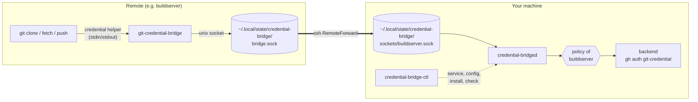
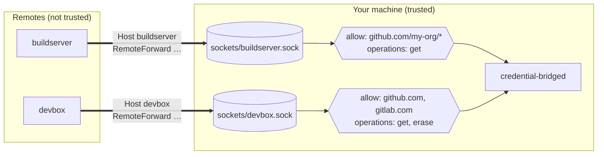
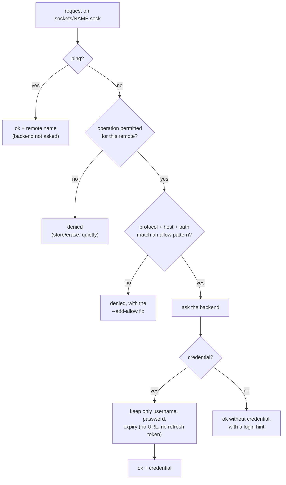
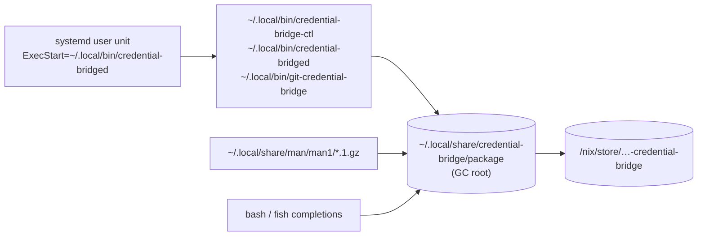
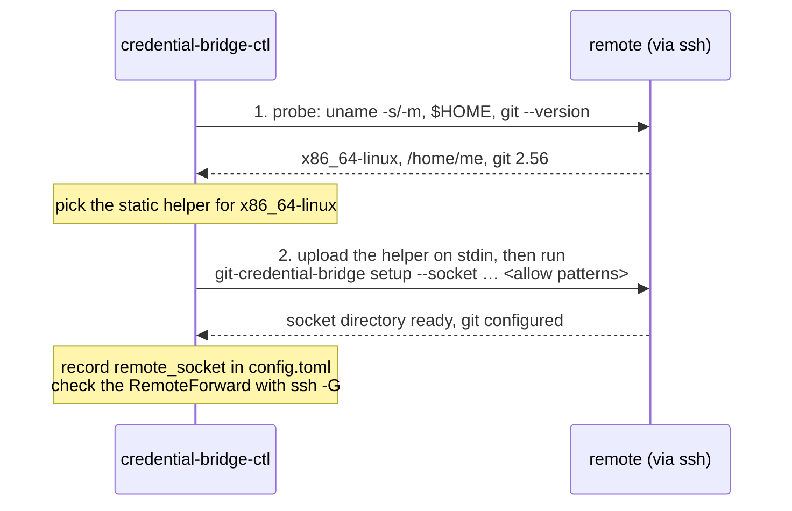
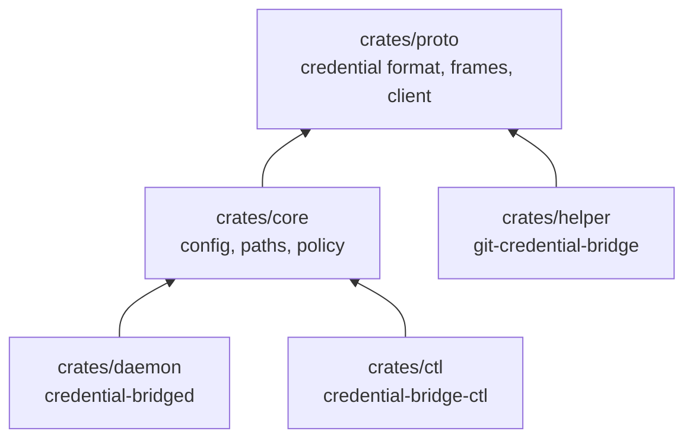
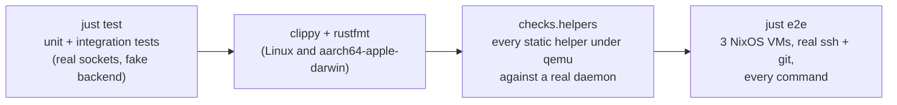

# Architecture

credential-bridge lets `git` on an SSH remote use the credentials of your local machine.
The token never leaves your machine except as the answer to a single request, and it is
never stored on the remote.

This document explains how that works, from the big picture down to the wire format. The
[README](../README.md) has the short version and the commands.

- [Components](#components)
- [A request, end to end](#a-request-end-to-end)
- [Why one socket per remote](#why-one-socket-per-remote)
- [Policy](#policy)
- [Wire protocol](#wire-protocol)
- [Installation](#installation)
- [Lifecycle and failure handling](#lifecycle-and-failure-handling)
- [Security properties](#security-properties)
- [Code layout, build and tests](#code-layout-build-and-tests)

## Components

Three programs, one on the remote and two on your machine:

| Program                 | Runs on | Role                                                                 |
| ----------------------- | ------- | -------------------------------------------------------------------- |
| `git-credential-bridge` | remote  | git's credential helper; forwards git's question through the socket  |
| `credential-bridged`    | local   | daemon; one socket per remote, checks the policy, asks the backend   |
| `credential-bridge-ctl` | local   | sets everything up: service, remotes, helper installation, diagnosis |



The only connection between the two machines is the SSH connection you open anyway.
`RemoteForward` in `~/.ssh/config` makes a socket on the remote lead to a socket on your
machine for as long as the connection lasts.

The **backend** is any git credential helper: by default `gh auth git-credential`, but
`osxkeychain`, `libsecret`, `manager` or your own command work the same way. The daemon
calls it exactly like git would.

## A request, end to end

What happens when you run `git clone https://github.com/my-org/repo` on the remote:

```mermaid
sequenceDiagram
    autonumber
    participant G as git (remote)
    participant H as git-credential-bridge
    participant S as ssh tunnel
    participant D as credential-bridged
    participant B as backend (gh)

    G->>H: get<br/>protocol=https, host=github.com, path=my-org/repo
    H->>S: credential-bridge/1 get …
    S->>D: (arrives on sockets/buildserver.sock)
    D->>D: policy of buildserver: get allowed? URL allowed?
    D->>B: gh auth git-credential get
    B-->>D: username=…, password=<token>
    D-->>S: credential-bridge/1 ok …
    S-->>H: (back through the tunnel)
    H-->>G: username=…, password=<token>
    Note over G: git uses the token for this one request
    G->>H: store (git reports success)
    H->>D: credential-bridge/1 store …
    D-->>H: denied (get-only policy), quietly
    Note over H: nothing printed; the token is not stored anywhere
```

Things to note:

- git asks once per operation; the token exists on the remote only in git's memory.
- After using a credential git always sends `store` (or `erase` after a failure). With
  the default get-only policy those are refused, and the helper stays silent about it.
- If anything goes wrong, the helper prints one line with the problem and one with the
  fix, then returns no credential, so git falls back to prompting:

```text
credential-bridge: github.com/other/repo is not allowed for this remote
  → locally: credential-bridge-ctl remote edit buildserver --add-allow 'https://github.com/other/*'
```

## Why one socket per remote

Every connection that arrives through `RemoteForward` looks the same to the daemon: a
local connection from your own `ssh` process. The daemon cannot tell which remote it
came from, and anything the remote _says_ about itself could be forged by whoever has
access to that remote.

So the daemon opens **one socket per remote**, and the socket a request arrives on
decides which policy applies. Your ssh config wires each host to its own socket; the
remote cannot choose another one.



On the remote side the socket always has the same name (`bridge.sock`), so the helper
does not need to know what the remote is called on your machine.

## Policy

Each remote has an allow list of URL patterns and a list of permitted operations (`get`
by default). A request is answered only if both match:



Pattern rules:

- `https://github.com` matches every repository on the host.
- `https://github.com/my-org/*` needs the request path; `remote install` sets
  `credential.<url>.useHttpPath` on the remote for that. `*` matches across `/`, and a
  trailing `.git` is optional.
- `*` in the host matches within one DNS label: `https://*.example.com`.

Of the backend's answer, the remote gets only `username`, `password`,
`password_expiry_utc`, `authtype`, `credential` and `ephemeral`. A backend can therefore
never redirect a credential to another URL than the one asked for, and long-lived
material such as an `oauth_refresh_token` never leaves your machine.

A `*` never stretches over URL syntax: hosts must be plain names (letters, digits, `-`,
`_`, `.`, a port), so `intranet#.example.com` does not pass `https://*.example.com`, and
paths with `%`, `?`, `#` or `\` match no pattern. Paths longer than 4096 bytes match
nothing either, and matching takes linear time per star, so a hostile remote cannot
stall the daemon with crafted paths.

Note that path patterns decide which requests are _answered_; a `gh` token itself is not
limited to those repositories.

## Wire protocol

Between helper and daemon: one request and one response per connection, in the same
`key=value` format git uses for credential helpers, with a header line.

```text
request:   credential-bridge/1 get
           protocol=https
           host=github.com
           path=my-org/repo
           <empty line>

response:  credential-bridge/1 ok
           username=me
           password=gho_…
           <empty line>

           credential-bridge/1 denied github.com/other/repo is not allowed for this remote → locally: …
           <empty line>
```

- Operations: `get`, `store`, `erase`, `ping`. Status: `ok`, `denied`, `error`.
- A message may carry its fix after `→`; the helper prints the two parts on two lines.
- The version in the header (`/1`) lets old and new programs detect each other.
- Requests are limited in size, and the daemon waits at most 10 seconds for one.
- A status message is at most 512 bytes; a long problem is shortened so its fix stays
  whole, and the fix is quoted for the shell, since people paste it.

## Installation

### On your machine

`just install` (or `nix run .#install`) builds the bundle and links it into `~/.local`.
A GC root keeps the Nix store path alive, and every link goes through that root, so an
update only swaps one link:



`credential-bridge-ctl service install` writes a systemd user unit (Linux) or a launchd
agent (macOS). It records the path you called the tools by (`~/.local/bin/…`), never the
resolved store path, so the service survives updates and garbage collection.

### On a remote

`credential-bridge-ctl remote install <name>` needs two ssh connections:



The helper registers itself, the way `gh auth setup-git` does locally. For every host in
the allow list it writes:

```ini
[credential "https://github.com"]
    helper =                    # reset helpers from other config files for this host
    helper = /home/me/.local/bin/git-credential-bridge --socket /home/me/.local/state/credential-bridge/bridge.sock
    useHttpPath = true          # only if a pattern for this host has a path
```

and creates `~/.local/state/credential-bridge/` (mode 0700), because sshd creates the
forwarded socket but not its directory.
`git-credential-bridge uninstall --remove-binary` undoes all of it; `remote uninstall`
runs exactly that.

The helpers are static binaries without dependencies: musl for x86_64 and aarch64, glibc
linked statically for s390x (Rust ships no musl std for s390x).

## Lifecycle and failure handling

| Situation                                      | What happens                                                                                                                                                                                                                                                                                                                                                                                                        |
| ---------------------------------------------- | ------------------------------------------------------------------------------------------------------------------------------------------------------------------------------------------------------------------------------------------------------------------------------------------------------------------------------------------------------------------------------------------------------------------- |
| Config changed (`remote add/edit/remove`)      | ctl sends SIGHUP; the daemon re-reads the config, keeps unchanged sockets listening with the new policy, binds new ones and closes removed ones. ctl waits until the daemon has recorded the new config's fingerprint in a local state file (never sent to remotes). A broken config keeps the old one running. The daemon handles SIGHUP from its first moment and tells systemd when it is ready (`Type=notify`). |
| Daemon restarts while ssh sessions are open    | The sockets are recreated at the same paths; open sessions keep working, because ssh connects to the local path anew for every request.                                                                                                                                                                                                                                                                             |
| Socket left over from a crashed daemon         | Replaced on start; a socket that still answers is never taken over.                                                                                                                                                                                                                                                                                                                                                 |
| Stale socket on the remote                     | sshd cannot bind the forward. `StreamLocalBindUnlink yes` in the remote's sshd_config avoids it; `remote check` names the fix.                                                                                                                                                                                                                                                                                      |
| Two sessions to the same remote                | The newest one owns `bridge.sock`; when it closes, the older ones lose it. `ControlMaster`/`ControlPersist` avoids that.                                                                                                                                                                                                                                                                                            |
| Backend has no credential (e.g. not logged in) | Answered as "no credential" with a login hint, not as an error.                                                                                                                                                                                                                                                                                                                                                     |
| Backend hangs                                  | Killed with its whole process group after `timeout_secs` (30 s).                                                                                                                                                                                                                                                                                                                                                    |

`credential-bridge-ctl remote check <name>` walks the whole chain from the remote's
point of view and stops at the first broken link:

```text
daemon ━ ssh config ━ ssh ━ helper ━ git    ready

daemon ━ ssh config ┄ ssh ┄ helper ┄ git    broken
  ✗ ssh config has no RemoteForward for the socket
    → credential-bridge-ctl remote ssh-config buildserver
```

If an ssh session already forwards the socket, `check` uses it instead of opening its
own forwarding, which would take the socket over and remove it on disconnect.

## Security properties

- **No token at rest on the remote.** Tokens exist there only in the memory of the git
  process that asked. `store` is refused unless you allow it.
- **Least privilege per remote.** Each remote sees only its allow list and operations.
- **Only you can talk to the daemon.** Socket directory 0700, sockets 0600, and the
  daemon checks the peer's uid on every connection.
- **Only short-lived answers.** Just username, password and expiry reach the remote; no
  URL attributes, no refresh tokens.
- **Nothing to inject.** Fix commands built from what a remote sent are shell-quoted.
- **Bounded work.** At most 8 requests per remote at once (more are refused at once),
  request size limit, read timeout, backend timeout with process group kill.
- **What it does not protect against:** someone with your user (or root) on the remote
  can use the forwarded socket while your session is open, within that remote's policy.
  The same holds for ssh agent forwarding. Keep the allow lists narrow for shared hosts.

## Code layout, build and tests



The helper depends only on `proto`, which keeps it small and free of configuration code.

Everything builds and tests through Nix (`nix flake check`, or `just check`):



- `checks.macos` type-checks and lints the launchd code for `aarch64-apple-darwin`,
  without a Mac.
- `checks.helpers` runs the x86_64, aarch64 and s390x helpers under qemu: version, ping,
  allowed and denied get, quiet store, `setup --dry-run`, no daemon.
- `checks.e2e` (`nix/e2e.nix`) boots `client`, `remote` and `bare` (no git, no
  `StreamLocalBindUnlink`) and runs every command, including the edge cases above.
